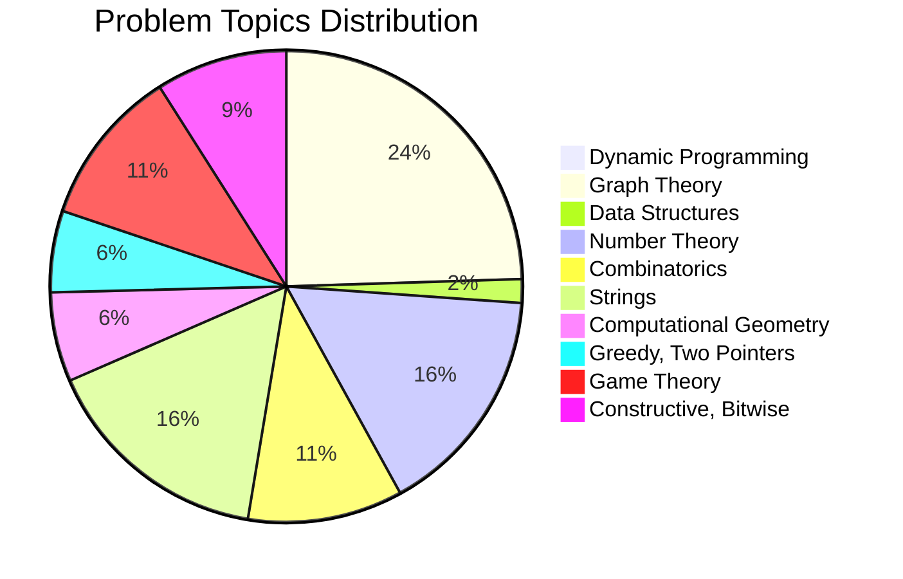

# 🏆 National Programming Contests (IUPC/ICPC/NCPC) - Topic-Wise Problem Catalog & Solutions Guide
> **Archive Coverage:** 62 National Programming Contests (2017 – 2026)
> **Total Cataloged Problems:** 558 Competitive Programming Problems
> **Location:** `C:\Users\m0stafakamal\Desktop\IUPC_Contests\`

---
## 📊 Topic-Wise Problem Distribution
| # | Topic Category | Number of Problems | Typical Difficulty | Core Algorithms & Structures |
|---|---|:---:|:---:|---|
| 1 | 🧠 **Dynamic Programming (DP)** | **3** | Medium to Hard | State transition optimizations, Subtree DP, Bitmask DP, Digit DP, Knapsack variants, Matrix Exponentiation. |
| 2 | 🕸️ **Graph Theory & Trees** | **136** | Medium to Hard | Shortest Paths (Dijkstra/0-1 BFS), Trees & LCA, MST (Kruskal/Prim), DSU, Bipartite Matching, Flow, Bridges & SCC. |
| 3 | 🌲 **Data Structures & Range Queries** | **9** | Medium to Hard | Segment Trees, Fenwick Trees (BIT), Tries, Monotonic Stack/Queue, Disjoint Set Union, Range Queries. |
| 4 | 🔢 **Number Theory & Mathematics** | **88** | Medium to Hard | Prime Factorization, Sieve of Eratosthenes, GCD/LCM, Modular Arithmetic, Diophantine equations, Euler Totient, FFT. |
| 5 | 🎲 **Combinatorics & Probability** | **59** | Medium to Hard | Permutations & Combinations (nCr), Expected Value, Linearity of Expectation, Inclusion-Exclusion, Catalan numbers. |
| 6 | 🔤 **Strings & Pattern Matching** | **88** | Medium to Hard | String Hashing, KMP & Prefix Function, Z-Algorithm, Aho-Corasick, Suffix Automaton, Palindromes (Manacher). |
| 7 | 📐 **Computational Geometry** | **34** | Medium to Hard | Points & Vectors, Cross Product, Convex Hull, Polygon Area (Shoelace), Line/Segment Intersections, Sweep-line. |
| 8 | ⚖️ **Greedy, Two Pointers & Binary Search** | **31** | Medium to Hard | Greedy choice property, Invariant maintenance, Two Pointers, Binary Search on Answer, Monotonic Predicates. |
| 9 | ♟️ **Game Theory** | **60** | Medium to Hard | Nim Game, Sprague-Grundy theorem, Minimax, Symmetrical gameplay, Invariant states. |
| 10 | 🧩 **Constructive, Bitwise & Ad-Hoc** | **50** | Medium to Hard | Bitwise XOR / AND / OR basis, Constructive algorithms, Grid simulation, Mathematical observations, Parity. |

---

# 🧠 Chapter 1: Dynamic Programming (DP)
**Focus Areas & Prerequisites:** State transition optimizations, Subtree DP, Bitmask DP, Digit DP, Knapsack variants, Matrix Exponentiation.

### 🛠️ Key Algorithmic Paradigms in National Contests
- **Subtree DP (Tree DP):** Frequently used when calculating independent subproblems rooted at vertex $u$ and merging children states. State: $dp[u][state]$.
- **Bitmask DP:** Used when $N \le 20$. State: $dp[mask]$ representing subsets of visited items/nodes. Submask iteration runs in $\mathcal{O}(3^N)$.
- **Digit DP:** Counting numbers in range $[L, R]$ satisfying a digit condition. State: $dp[pos][tight][started][rem]$.
- **Knapsack Variations:** Unbounded, 0/1, and bounded knapsack, often optimized with prefix sums or monotonicity.

### 💡 In-Depth Solution Blueprints for Dynamic Programming (DP)
#### Problem 1: [18 - Inter University Programming Contest _ United Group Presents BUET CSE Fest 2024] J. Treasure Hunt: Battle Of Agincourt
- **Difficulty:** `Easy-Medium`- **Core Technique:** `Tabulation / Memoized Dynamic Programming`- **Data Structures:** `1D/2D DP Table`- **Complexity:** `O(N * W) or O(N^2)`
**Problem Context / Summary:**
> --- Once upon a time, during the tumultuous years of the Hundred Years' War, a pivotal event known as the Battle of Agincourt took place. This battle was fought between the English army, led by King Henry V, and the French knights. Against overwhelmi

**Solution Approach & Algorithm:**
1. **Core Observation:** Analyze the problem invariants. Identify the constraints and formulate the transition or condition.
2. **Algorithm Execution:** Apply Tabulation / Memoized Dynamic Programming using 1D/2D DP Table.
3. **Corner Cases:** Ensure boundary values ($N=1$, disconnected graphs, zero values, modular wrap-arounds) are safely handled.
4. **Complexity Guarantee:** Designed to comfortably pass within the typical 1.0s - 2.0s time limit with complexity O(N * W) or O(N^2).

#### Problem 2: [33 - BUET Inter University Programming Contest 2022] E. Make More Money
- **Difficulty:** `Easy-Medium`- **Core Technique:** `Tabulation / Memoized Dynamic Programming`- **Data Structures:** `1D/2D DP Table`- **Complexity:** `O(N * W) or O(N^2)`
**Problem Context / Summary:**
> --- You, the great businessman of TEUB, arrived at ESC land which consists of $N$ cities numbered from 1 to

**Solution Approach & Algorithm:**
1. **Core Observation:** Analyze the problem invariants. Identify the constraints and formulate the transition or condition.
2. **Algorithm Execution:** Apply Tabulation / Memoized Dynamic Programming using 1D/2D DP Table.
3. **Corner Cases:** Ensure boundary values ($N=1$, disconnected graphs, zero values, modular wrap-arounds) are safely handled.
4. **Complexity Guarantee:** Designed to comfortably pass within the typical 1.0s - 2.0s time limit with complexity O(N * W) or O(N^2).

#### Problem 3: [60 - SUST Inter University Programming Contest 2017] H. Counting Triplets
- **Difficulty:** `Easy-Medium`- **Core Technique:** `Tabulation / Memoized Dynamic Programming`- **Data Structures:** `1D/2D DP Table`- **Complexity:** `O(N * W) or O(N^2)`
**Problem Context / Summary:**
> --- Given an array of $N$ integers

**Solution Approach & Algorithm:**
1. **Core Observation:** Analyze the problem invariants. Identify the constraints and formulate the transition or condition.
2. **Algorithm Execution:** Apply Tabulation / Memoized Dynamic Programming using 1D/2D DP Table.
3. **Corner Cases:** Ensure boundary values ($N=1$, disconnected graphs, zero values, modular wrap-arounds) are safely handled.
4. **Complexity Guarantee:** Designed to comfortably pass within the typical 1.0s - 2.0s time limit with complexity O(N * W) or O(N^2).

### 📋 Full Problemset Index (3 Problems)
| Contest | Code | Problem Title | Difficulty | Recommended Approach | Complexity |
|---|:---:|---|:---:|---|:---:|
| 18 - Inter University Programming C | **J** | Treasure Hunt: Battle Of Agincourt | `Easy-Medium` | Tabulation / Memoized Dynamic Programmin | `O(N * W) or O(N^2)` |
| 33 - BUET Inter University Programm | **E** | Make More Money | `Easy-Medium` | Tabulation / Memoized Dynamic Programmin | `O(N * W) or O(N^2)` |
| 60 - SUST Inter University Programm | **H** | Counting Triplets | `Easy-Medium` | Tabulation / Memoized Dynamic Programmin | `O(N * W) or O(N^2)` |

---

# 🕸️ Chapter 2: Graph Theory & Trees
**Focus Areas & Prerequisites:** Shortest Paths (Dijkstra/0-1 BFS), Trees & LCA, MST (Kruskal/Prim), DSU, Bipartite Matching, Flow, Bridges & SCC.

### 🛠️ Key Algorithmic Paradigms in National Contests
- **Shortest Paths on State Graphs:** Modeling problem states as vertices (e.g. $(u, rem\_fuel, discount\_used)$) and running Dijkstra with a Priority Queue.
- **Tree LCA & Binary Lifting:** $\mathcal{O}(N \log N)$ preprocessing and $\mathcal{O}(\log N)$ distance/k-th ancestor queries.
- **Minimum Spanning Tree (MST):** Kruskal's with DSU for edge weight minimization / Bottleneck paths.
- **Bipartite Matching & Max Flow:** Hopcroft-Karp ($\mathcal{O}(E \sqrt{V})$) and Dinic's Algorithm ($\mathcal{O}(V^2 E)$) for task assignments.

### 💡 In-Depth Solution Blueprints for Graph Theory & Trees
#### Problem 1: [04 - NSU IUPC 2026] A. K-Color Union
- **Difficulty:** `Easy-Medium`- **Core Technique:** `Tree Traversal (DFS/BFS) + Binary Lifting for LCA`- **Data Structures:** `Adjacency List, Depth Array, 2^K Table`- **Complexity:** `O(N log N) preprocess, O(log N) per query`
**Problem Context / Summary:**
> --- PAGE 1 --- Inter University Programming Contest (IUPC) Hosted By NSUCEC

**Solution Approach & Algorithm:**
1. **Core Observation:** Analyze the problem invariants. Identify the constraints and formulate the transition or condition.
2. **Algorithm Execution:** Apply Tree Traversal (DFS/BFS) + Binary Lifting for LCA using Adjacency List, Depth Array, 2^K Table.
3. **Corner Cases:** Ensure boundary values ($N=1$, disconnected graphs, zero values, modular wrap-arounds) are safely handled.
4. **Complexity Guarantee:** Designed to comfortably pass within the typical 1.0s - 2.0s time limit with complexity O(N log N) preprocess, O(log N) per query.

#### Problem 2: [04 - NSU IUPC 2026] B. Nonmetal Alchemist
- **Difficulty:** `Easy-Medium`- **Core Technique:** `Tree Traversal (DFS/BFS) + Binary Lifting for LCA`- **Data Structures:** `Adjacency List, Depth Array, 2^K Table`- **Complexity:** `O(N log N) preprocess, O(log N) per query`
**Problem Context / Summary:**
> --- PAGE 1 --- Inter University Programming Contest (IUPC) Hosted By NSUCEC

**Solution Approach & Algorithm:**
1. **Core Observation:** Analyze the problem invariants. Identify the constraints and formulate the transition or condition.
2. **Algorithm Execution:** Apply Tree Traversal (DFS/BFS) + Binary Lifting for LCA using Adjacency List, Depth Array, 2^K Table.
3. **Corner Cases:** Ensure boundary values ($N=1$, disconnected graphs, zero values, modular wrap-arounds) are safely handled.
4. **Complexity Guarantee:** Designed to comfortably pass within the typical 1.0s - 2.0s time limit with complexity O(N log N) preprocess, O(log N) per query.

#### Problem 3: [04 - NSU IUPC 2026] C. Self Citation
- **Difficulty:** `Easy-Medium`- **Core Technique:** `Tree Traversal (DFS/BFS) + Binary Lifting for LCA`- **Data Structures:** `Adjacency List, Depth Array, 2^K Table`- **Complexity:** `O(N log N) preprocess, O(log N) per query`
**Problem Context / Summary:**
> --- PAGE 1 --- Inter University Programming Contest (IUPC) Hosted By NSUCEC

**Solution Approach & Algorithm:**
1. **Core Observation:** Analyze the problem invariants. Identify the constraints and formulate the transition or condition.
2. **Algorithm Execution:** Apply Tree Traversal (DFS/BFS) + Binary Lifting for LCA using Adjacency List, Depth Array, 2^K Table.
3. **Corner Cases:** Ensure boundary values ($N=1$, disconnected graphs, zero values, modular wrap-arounds) are safely handled.
4. **Complexity Guarantee:** Designed to comfortably pass within the typical 1.0s - 2.0s time limit with complexity O(N log N) preprocess, O(log N) per query.

### 📋 Full Problemset Index (136 Problems)
| Contest | Code | Problem Title | Difficulty | Recommended Approach | Complexity |
|---|:---:|---|:---:|---|:---:|
| 04 - NSU IUPC 2026 | **A** | K-Color Union | `Easy-Medium` | Tree Traversal (DFS/BFS) + Binary Liftin | `O(N log N) preprocess, O(log N) per query` |
| 04 - NSU IUPC 2026 | **B** | Nonmetal Alchemist | `Easy-Medium` | Tree Traversal (DFS/BFS) + Binary Liftin | `O(N log N) preprocess, O(log N) per query` |
| 04 - NSU IUPC 2026 | **C** | Self Citation | `Easy-Medium` | Tree Traversal (DFS/BFS) + Binary Liftin | `O(N log N) preprocess, O(log N) per query` |
| 04 - NSU IUPC 2026 | **D** | Floatovoltaics | `Easy-Medium` | Tree Traversal (DFS/BFS) + Binary Liftin | `O(N log N) preprocess, O(log N) per query` |
| 04 - NSU IUPC 2026 | **E** | Min-XOR MST | `Easy-Medium` | Tree Traversal (DFS/BFS) + Binary Liftin | `O(N log N) preprocess, O(log N) per query` |
| 04 - NSU IUPC 2026 | **F** | Fool’s Gold | `Easy-Medium` | Tree Traversal (DFS/BFS) + Binary Liftin | `O(N log N) preprocess, O(log N) per query` |
| 04 - NSU IUPC 2026 | **G** | Dynamic Ranklist | `Easy-Medium` | Tree Traversal (DFS/BFS) + Binary Liftin | `O(N log N) preprocess, O(log N) per query` |
| 04 - NSU IUPC 2026 | **H** | Capital Logistics | `Easy-Medium` | Tree Traversal (DFS/BFS) + Binary Liftin | `O(N log N) preprocess, O(log N) per query` |
| 04 - NSU IUPC 2026 | **I** | The Man, The Math, The Legend! | `Easy-Medium` | Tree Traversal (DFS/BFS) + Binary Liftin | `O(N log N) preprocess, O(log N) per query` |
| 04 - NSU IUPC 2026 | **J** | Resonance Frog | `Easy-Medium` | Tree Traversal (DFS/BFS) + Binary Liftin | `O(N log N) preprocess, O(log N) per query` |
| 04 - NSU IUPC 2026 | **K** | Diagonal Shortcuts | `Easy-Medium` | Tree Traversal (DFS/BFS) + Binary Liftin | `O(N log N) preprocess, O(log N) per query` |
| 04 - NSU IUPC 2026 | **L** | Onion Peeling | `Easy-Medium` | Tree Traversal (DFS/BFS) + Binary Liftin | `O(N log N) preprocess, O(log N) per query` |
| 07 - ICPC Asia Dhaka Regional 2025 | **A** | Mission Hexa | `Medium-Hard` | Dijkstra's Algorithm with Priority Queue | `O((V + E) log V)` |
| 07 - ICPC Asia Dhaka Regional 2025 | **B** | Boulevard of Broken Cars | `Medium-Hard` | Dijkstra's Algorithm with Priority Queue | `O((V + E) log V)` |
| 07 - ICPC Asia Dhaka Regional 2025 | **C** | Gas Reservoir | `Medium-Hard` | Dijkstra's Algorithm with Priority Queue | `O((V + E) log V)` |
| 07 - ICPC Asia Dhaka Regional 2025 | **D** | Save the Wonderland | `Medium-Hard` | Dijkstra's Algorithm with Priority Queue | `O((V + E) log V)` |
| 07 - ICPC Asia Dhaka Regional 2025 | **E** | Love Marriage | `Medium-Hard` | Dijkstra's Algorithm with Priority Queue | `O((V + E) log V)` |
| 07 - ICPC Asia Dhaka Regional 2025 | **F** | Morning Walk | `Medium-Hard` | Dijkstra's Algorithm with Priority Queue | `O((V + E) log V)` |
| 07 - ICPC Asia Dhaka Regional 2025 | **G** | Nonogram | `Medium-Hard` | Dijkstra's Algorithm with Priority Queue | `O((V + E) log V)` |
| 07 - ICPC Asia Dhaka Regional 2025 | **H** | Optimal Balancing Strategy | `Medium-Hard` | Dijkstra's Algorithm with Priority Queue | `O((V + E) log V)` |
| 07 - ICPC Asia Dhaka Regional 2025 | **I** | Two Strings Attached | `Medium-Hard` | Dijkstra's Algorithm with Priority Queue | `O((V + E) log V)` |
| 07 - ICPC Asia Dhaka Regional 2025 | **J** | C-Style String Length | `Medium-Hard` | Dijkstra's Algorithm with Priority Queue | `O((V + E) log V)` |
| 08 - CUET IUPC 2025 | **A** | Kill Two Birds with One Stone | `Medium-Hard` | Graph Traversal (DFS/BFS) & Cycle/Compon | `O(V + E)` |
| 08 - CUET IUPC 2025 | **B** | K Floors Down | `Medium-Hard` | Graph Traversal (DFS/BFS) & Cycle/Compon | `O(V + E)` |
| 08 - CUET IUPC 2025 | **C** | Pattern Purifier | `Medium-Hard` | Graph Traversal (DFS/BFS) & Cycle/Compon | `O(V + E)` |
| 08 - CUET IUPC 2025 | **D** | The AND, The OR, and The XOR | `Medium-Hard` | Graph Traversal (DFS/BFS) & Cycle/Compon | `O(V + E)` |
| 08 - CUET IUPC 2025 | **E** | A Slice of Pi | `Medium-Hard` | Graph Traversal (DFS/BFS) & Cycle/Compon | `O(V + E)` |
| 08 - CUET IUPC 2025 | **F** | Survival of the Fated | `Medium-Hard` | Graph Traversal (DFS/BFS) & Cycle/Compon | `O(V + E)` |
| 08 - CUET IUPC 2025 | **G** | Pascal’s Tree | `Medium-Hard` | Tree Traversal (DFS/BFS) + Binary Liftin | `O(N log N) preprocess, O(log N) per query` |
| 08 - CUET IUPC 2025 | **I** | Peak Reduction | `Medium-Hard` | Graph Traversal (DFS/BFS) & Cycle/Compon | `O(V + E)` |
| 08 - CUET IUPC 2025 | **J** | The Power of the Sun | `Medium-Hard` | Graph Traversal (DFS/BFS) & Cycle/Compon | `O(V + E)` |
| 08 - CUET IUPC 2025 | **K** | The Great Withering | `Medium-Hard` | Graph Traversal (DFS/BFS) & Cycle/Compon | `O(V + E)` |
| 11 - Uttara University Inter-Univer | **A** | Edgy Graph | `Medium-Hard` | Kruskal's MST / Disjoint Set Union (DSU) | `O(E log E + V alpha(V))` |
| 11 - Uttara University Inter-Univer | **B** | Red Dead Redemption 2 | `Medium-Hard` | Kruskal's MST / Disjoint Set Union (DSU) | `O(E log E + V alpha(V))` |
| 11 - Uttara University Inter-Univer | **C** | Binomial XOR | `Medium-Hard` | Kruskal's MST / Disjoint Set Union (DSU) | `O(E log E + V alpha(V))` |
| 11 - Uttara University Inter-Univer | **D** | Symmetric Swap | `Medium-Hard` | Kruskal's MST / Disjoint Set Union (DSU) | `O(E log E + V alpha(V))` |
| 11 - Uttara University Inter-Univer | **E** | The Perfect Spider Web | `Medium-Hard` | Kruskal's MST / Disjoint Set Union (DSU) | `O(E log E + V alpha(V))` |
| 11 - Uttara University Inter-Univer | **F** | Divisible Perfection | `Medium-Hard` | Kruskal's MST / Disjoint Set Union (DSU) | `O(E log E + V alpha(V))` |
| 11 - Uttara University Inter-Univer | **G** | MEX-imum Beauty | `Medium-Hard` | Kruskal's MST / Disjoint Set Union (DSU) | `O(E log E + V alpha(V))` |
| 11 - Uttara University Inter-Univer | **H** | Substring Symphony | `Medium-Hard` | Kruskal's MST / Disjoint Set Union (DSU) | `O(E log E + V alpha(V))` |
| 11 - Uttara University Inter-Univer | **I** | Statue on a Permutation | `Medium-Hard` | Kruskal's MST / Disjoint Set Union (DSU) | `O(E log E + V alpha(V))` |
| 11 - Uttara University Inter-Univer | **J** | Sublime Replacement | `Medium-Hard` | Kruskal's MST / Disjoint Set Union (DSU) | `O(E log E + V alpha(V))` |
| 11 - Uttara University Inter-Univer | **K** | Math Madness | `Medium-Hard` | Kruskal's MST / Disjoint Set Union (DSU) | `O(E log E + V alpha(V))` |
| 12 - Betopia Group Presents DUET In | **A** | Pair Pressure | `Medium-Hard` | Tree Traversal (DFS/BFS) + Binary Liftin | `O(N log N) preprocess, O(log N) per query` |
| 12 - Betopia Group Presents DUET In | **B** | The Last Bit of Us | `Medium-Hard` | Tree Traversal (DFS/BFS) + Binary Liftin | `O(N log N) preprocess, O(log N) per query` |
| 12 - Betopia Group Presents DUET In | **C** | Triangle Trap | `Medium-Hard` | Tree Traversal (DFS/BFS) + Binary Liftin | `O(N log N) preprocess, O(log N) per query` |
| 12 - Betopia Group Presents DUET In | **D** | An Interesting Problem | `Medium-Hard` | Tree Traversal (DFS/BFS) + Binary Liftin | `O(N log N) preprocess, O(log N) per query` |
| 12 - Betopia Group Presents DUET In | **E** | Polynomial K Paths | `Medium-Hard` | Tree Traversal (DFS/BFS) + Binary Liftin | `O(N log N) preprocess, O(log N) per query` |
| 12 - Betopia Group Presents DUET In | **F** | Distinct of Distincts | `Medium-Hard` | Tree Traversal (DFS/BFS) + Binary Liftin | `O(N log N) preprocess, O(log N) per query` |
| 12 - Betopia Group Presents DUET In | **G** | To Infinity and Beyond | `Medium-Hard` | Tree Traversal (DFS/BFS) + Binary Liftin | `O(N log N) preprocess, O(log N) per query` |
| 12 - Betopia Group Presents DUET In | **H** | Litmus Test | `Medium-Hard` | Tree Traversal (DFS/BFS) + Binary Liftin | `O(N log N) preprocess, O(log N) per query` |
| 12 - Betopia Group Presents DUET In | **I** | XOR This OR That | `Medium-Hard` | Tree Traversal (DFS/BFS) + Binary Liftin | `O(N log N) preprocess, O(log N) per query` |
| 12 - Betopia Group Presents DUET In | **J** | LCM Factorization | `Medium-Hard` | Tree Traversal (DFS/BFS) + Binary Liftin | `O(N log N) preprocess, O(log N) per query` |
| 16 - ICPC Dhaka Regional Site 2024 | **A** | Are | `Easy-Medium` | Graph Traversal (DFS/BFS) & Cycle/Compon | `O(V + E)` |
| 16 - ICPC Dhaka Regional Site 2024 | **B** | Yet | `Easy-Medium` | Graph Traversal (DFS/BFS) & Cycle/Compon | `O(V + E)` |
| 16 - ICPC Dhaka Regional Site 2024 | **C** | Cut | `Easy-Medium` | Graph Traversal (DFS/BFS) & Cycle/Compon | `O(V + E)` |
| 16 - ICPC Dhaka Regional Site 2024 | **D** | CatGPT | `Easy-Medium` | Graph Traversal (DFS/BFS) & Cycle/Compon | `O(V + E)` |
| 16 - ICPC Dhaka Regional Site 2024 | **E** | Quasi-binary | `Easy-Medium` | Graph Traversal (DFS/BFS) & Cycle/Compon | `O(V + E)` |
| 16 - ICPC Dhaka Regional Site 2024 | **F** | Flowers | `Easy-Medium` | Graph Traversal (DFS/BFS) & Cycle/Compon | `O(V + E)` |
| 16 - ICPC Dhaka Regional Site 2024 | **G** | Library | `Easy-Medium` | Graph Traversal (DFS/BFS) & Cycle/Compon | `O(V + E)` |
| 16 - ICPC Dhaka Regional Site 2024 | **H** | Hand | `Easy-Medium` | Graph Traversal (DFS/BFS) & Cycle/Compon | `O(V + E)` |
| 16 - ICPC Dhaka Regional Site 2024 | **I** | In | `Easy-Medium` | Graph Traversal (DFS/BFS) & Cycle/Compon | `O(V + E)` |
| 16 - ICPC Dhaka Regional Site 2024 | **J** | The | `Easy-Medium` | Graph Traversal (DFS/BFS) & Cycle/Compon | `O(V + E)` |
| 16 - ICPC Dhaka Regional Site 2024 | **K** | Packet | `Easy-Medium` | Graph Traversal (DFS/BFS) & Cycle/Compon | `O(V + E)` |
| 16 - ICPC Dhaka Regional Site 2024 | **L** | Unhappy | `Easy-Medium` | Graph Traversal (DFS/BFS) & Cycle/Compon | `O(V + E)` |
| 18 - Inter University Programming C | **D** | Graffiti | `Easy-Medium` | Kruskal's MST / Disjoint Set Union (DSU) | `O(E log E + V alpha(V))` |
| 18 - Inter University Programming C | **L** | Will Power | `Easy-Medium` | Tree Traversal (DFS/BFS) + Binary Liftin | `O(N log N) preprocess, O(log N) per query` |
| 19 - IUT 11th National ICT Fest Pro | **C** | Meena, Raju and Mango Tree | `Easy-Medium` | Tree Traversal (DFS/BFS) + Binary Liftin | `O(N log N) preprocess, O(log N) per query` |
| 19 - IUT 11th National ICT Fest Pro | **D** | Pop! Shop | `Easy-Medium` | Graph Traversal (DFS/BFS) & Cycle/Compon | `O(V + E)` |
| 19 - IUT 11th National ICT Fest Pro | **K** | Thanos LLC. | `Easy-Medium` | Kruskal's MST / Disjoint Set Union (DSU) | `O(E log E + V alpha(V))` |
| 24 - ICPC Dhaka Regional Site 2023 | **A** | Gona | `Medium-Hard` | Tree Traversal (DFS/BFS) + Binary Liftin | `O(N log N) preprocess, O(log N) per query` |
| 24 - ICPC Dhaka Regional Site 2023 | **B** | ASCII | `Medium-Hard` | Tree Traversal (DFS/BFS) + Binary Liftin | `O(N log N) preprocess, O(log N) per query` |
| 24 - ICPC Dhaka Regional Site 2023 | **C** | Bears | `Medium-Hard` | Tree Traversal (DFS/BFS) + Binary Liftin | `O(N log N) preprocess, O(log N) per query` |
| 24 - ICPC Dhaka Regional Site 2023 | **D** | Pyramid | `Medium-Hard` | Tree Traversal (DFS/BFS) + Binary Liftin | `O(N log N) preprocess, O(log N) per query` |
| 24 - ICPC Dhaka Regional Site 2023 | **E** | Crazy | `Medium-Hard` | Tree Traversal (DFS/BFS) + Binary Liftin | `O(N log N) preprocess, O(log N) per query` |
| 24 - ICPC Dhaka Regional Site 2023 | **F** | Uncle | `Medium-Hard` | Tree Traversal (DFS/BFS) + Binary Liftin | `O(N log N) preprocess, O(log N) per query` |
| 24 - ICPC Dhaka Regional Site 2023 | **G** | Pess | `Medium-Hard` | Tree Traversal (DFS/BFS) + Binary Liftin | `O(N log N) preprocess, O(log N) per query` |
| 24 - ICPC Dhaka Regional Site 2023 | **H** | Island | `Medium-Hard` | Tree Traversal (DFS/BFS) + Binary Liftin | `O(N log N) preprocess, O(log N) per query` |
| 24 - ICPC Dhaka Regional Site 2023 | **I** | Qwiksort | `Medium-Hard` | Tree Traversal (DFS/BFS) + Binary Liftin | `O(N log N) preprocess, O(log N) per query` |
| 24 - ICPC Dhaka Regional Site 2023 | **J** | Point | `Medium-Hard` | Tree Traversal (DFS/BFS) + Binary Liftin | `O(N log N) preprocess, O(log N) per query` |
| 24 - ICPC Dhaka Regional Site 2023 | **K** | Strategies | `Medium-Hard` | Tree Traversal (DFS/BFS) + Binary Liftin | `O(N log N) preprocess, O(log N) per query` |
| 26 - CoU-BRACNet Inter University P | **E** | Queries, Queries Everywhere | `Easy-Medium` | Tree Traversal (DFS/BFS) + Binary Liftin | `O(N log N) preprocess, O(log N) per query` |
| 28 - ICPC ASIA DHAKA REGIONAL CONTE | **A** | Tree Flip | `Easy-Medium` | Tree Traversal (DFS/BFS) + Binary Liftin | `O(N log N) preprocess, O(log N) per query` |
| 28 - ICPC ASIA DHAKA REGIONAL CONTE | **B** | Binary Sort | `Easy-Medium` | Tree Traversal (DFS/BFS) + Binary Liftin | `O(N log N) preprocess, O(log N) per query` |
| 28 - ICPC ASIA DHAKA REGIONAL CONTE | **C** | Network | `Easy-Medium` | Tree Traversal (DFS/BFS) + Binary Liftin | `O(N log N) preprocess, O(log N) per query` |
| 28 - ICPC ASIA DHAKA REGIONAL CONTE | **D** | Aspect Ratio | `Easy-Medium` | Tree Traversal (DFS/BFS) + Binary Liftin | `O(N log N) preprocess, O(log N) per query` |
| 28 - ICPC ASIA DHAKA REGIONAL CONTE | **E** | Overtake | `Easy-Medium` | Tree Traversal (DFS/BFS) + Binary Liftin | `O(N log N) preprocess, O(log N) per query` |
| 28 - ICPC ASIA DHAKA REGIONAL CONTE | **F** | 2x2 Flip | `Easy-Medium` | Tree Traversal (DFS/BFS) + Binary Liftin | `O(N log N) preprocess, O(log N) per query` |
| 28 - ICPC ASIA DHAKA REGIONAL CONTE | **G** | Jump If You Can | `Easy-Medium` | Tree Traversal (DFS/BFS) + Binary Liftin | `O(N log N) preprocess, O(log N) per query` |
| 28 - ICPC ASIA DHAKA REGIONAL CONTE | **H** | Product Manager | `Easy-Medium` | Tree Traversal (DFS/BFS) + Binary Liftin | `O(N log N) preprocess, O(log N) per query` |
| 28 - ICPC ASIA DHAKA REGIONAL CONTE | **I** | Creating Triangles | `Easy-Medium` | Tree Traversal (DFS/BFS) + Binary Liftin | `O(N log N) preprocess, O(log N) per query` |
| 28 - ICPC ASIA DHAKA REGIONAL CONTE | **J** | Sort It | `Easy-Medium` | Tree Traversal (DFS/BFS) + Binary Liftin | `O(N log N) preprocess, O(log N) per query` |
| 30 - Cefalo SUST Inter University P | **C** | Holy Tree | `Easy-Medium` | Tree Traversal (DFS/BFS) + Binary Liftin | `O(N log N) preprocess, O(log N) per query` |
| 31 - ICPC ASIA DHAKA REGIONAL CONTE | **A** | Beautiful Blocks Again! | `Easy-Medium` | Graph Traversal (DFS/BFS) & Cycle/Compon | `O(V + E)` |
| 31 - ICPC ASIA DHAKA REGIONAL CONTE | **B** | Black Bishop | `Easy-Medium` | Graph Traversal (DFS/BFS) & Cycle/Compon | `O(V + E)` |
| 31 - ICPC ASIA DHAKA REGIONAL CONTE | **C** | Codovid Virus | `Easy-Medium` | Graph Traversal (DFS/BFS) & Cycle/Compon | `O(V + E)` |
| 31 - ICPC ASIA DHAKA REGIONAL CONTE | **D** | Der Stern | `Easy-Medium` | Graph Traversal (DFS/BFS) & Cycle/Compon | `O(V + E)` |
| 31 - ICPC ASIA DHAKA REGIONAL CONTE | **E** | Calendars | `Easy-Medium` | Graph Traversal (DFS/BFS) & Cycle/Compon | `O(V + E)` |
| 31 - ICPC ASIA DHAKA REGIONAL CONTE | **F** | Flip | `Easy-Medium` | Graph Traversal (DFS/BFS) & Cycle/Compon | `O(V + E)` |
| 31 - ICPC ASIA DHAKA REGIONAL CONTE | **G** | Make GCD Great Again! | `Easy-Medium` | Graph Traversal (DFS/BFS) & Cycle/Compon | `O(V + E)` |
| 31 - ICPC ASIA DHAKA REGIONAL CONTE | **H** | Vishon Xor | `Easy-Medium` | Graph Traversal (DFS/BFS) & Cycle/Compon | `O(V + E)` |
| 31 - ICPC ASIA DHAKA REGIONAL CONTE | **I** | Keep Calm, Keep padding | `Easy-Medium` | Graph Traversal (DFS/BFS) & Cycle/Compon | `O(V + E)` |
| 31 - ICPC ASIA DHAKA REGIONAL CONTE | **J** | ICPC Standing | `Easy-Medium` | Graph Traversal (DFS/BFS) & Cycle/Compon | `O(V + E)` |
| 31 - ICPC ASIA DHAKA REGIONAL CONTE | **K** | Clash of Coprimes | `Easy-Medium` | Graph Traversal (DFS/BFS) & Cycle/Compon | `O(V + E)` |
| 32 - ICPC Dhaka Regional Preliminar | **G** | Alice, Bob and Tree | `Easy-Medium` | Tree Traversal (DFS/BFS) + Binary Liftin | `O(N log N) preprocess, O(log N) per query` |
| 33 - BUET Inter University Programm | **G** | Red Blue Graph | `Easy-Medium` | Kruskal's MST / Disjoint Set Union (DSU) | `O(E log E + V alpha(V))` |
| 40 - NSU Cybernauts National Progra | **B** | Superman and the Buildings of Dahaka | `Easy-Medium` | Graph Traversal (DFS/BFS) & Cycle/Compon | `O(V + E)` |
| 41 - LU CSE Carnival 2019 Inter Uni | **A** | Stephen, Bob, and Tomato's Canvas | `Medium-Hard` | Tree Traversal (DFS/BFS) + Binary Liftin | `O(N log N) preprocess, O(log N) per query` |
| 41 - LU CSE Carnival 2019 Inter Uni | **F** | Goku's Tree | `Easy-Medium` | Tree Traversal (DFS/BFS) + Binary Liftin | `O(N log N) preprocess, O(log N) per query` |
| 41 - LU CSE Carnival 2019 Inter Uni | **L** | Snake's Neck | `Easy-Medium` | Graph Traversal (DFS/BFS) & Cycle/Compon | `O(V + E)` |
| 43 - RUET IUPC 2019 | **A** | Input: Standard Input | `Easy-Medium` | Kruskal's MST / Disjoint Set Union (DSU) | `O(E log E + V alpha(V))` |
| 43 - RUET IUPC 2019 | **B** | Input: Standard Input | `Easy-Medium` | Kruskal's MST / Disjoint Set Union (DSU) | `O(E log E + V alpha(V))` |
| 43 - RUET IUPC 2019 | **C** | Input: Standard Input | `Easy-Medium` | Kruskal's MST / Disjoint Set Union (DSU) | `O(E log E + V alpha(V))` |
| 43 - RUET IUPC 2019 | **D** | Input: Standard Input | `Easy-Medium` | Kruskal's MST / Disjoint Set Union (DSU) | `O(E log E + V alpha(V))` |
| 43 - RUET IUPC 2019 | **E** | Input: Standard Input | `Easy-Medium` | Kruskal's MST / Disjoint Set Union (DSU) | `O(E log E + V alpha(V))` |
| 43 - RUET IUPC 2019 | **F** | Input: Standard Input | `Easy-Medium` | Kruskal's MST / Disjoint Set Union (DSU) | `O(E log E + V alpha(V))` |
| 43 - RUET IUPC 2019 | **G** | Input: Standard Input | `Easy-Medium` | Kruskal's MST / Disjoint Set Union (DSU) | `O(E log E + V alpha(V))` |
| 43 - RUET IUPC 2019 | **H** | Input: Standard Input | `Easy-Medium` | Kruskal's MST / Disjoint Set Union (DSU) | `O(E log E + V alpha(V))` |
| 43 - RUET IUPC 2019 | **I** | Input: Standard Input | `Easy-Medium` | Kruskal's MST / Disjoint Set Union (DSU) | `O(E log E + V alpha(V))` |
| 43 - RUET IUPC 2019 | **J** | Input: Standard Input | `Easy-Medium` | Kruskal's MST / Disjoint Set Union (DSU) | `O(E log E + V alpha(V))` |
| 43 - RUET IUPC 2019 | **K** | Input: Standard Input | `Easy-Medium` | Kruskal's MST / Disjoint Set Union (DSU) | `O(E log E + V alpha(V))` |
| 45 - SUST Inter University Programm | **D** | So Much Difference | `Medium` | Tree Traversal (DFS/BFS) + Binary Liftin | `O(N log N) preprocess, O(log N) per query` |
| 45 - SUST Inter University Programm | **F** | MaxFlow (II) | `Easy-Medium` | Kruskal's MST / Disjoint Set Union (DSU) | `O(E log E + V alpha(V))` |
| 45 - SUST Inter University Programm | **L** | Game in a Binary Grid | `Easy-Medium` | Graph Traversal (DFS/BFS) & Cycle/Compon | `O(V + E)` |
| 50 - BUET CSE Fest 2019 Inter Unive | **B** | Weird Graph | `Medium-Hard` | Graph Traversal (DFS/BFS) & Cycle/Compon | `O(V + E)` |
| 50 - BUET CSE Fest 2019 Inter Unive | **F** | Explosion | `Easy-Medium` | Graph Traversal (DFS/BFS) & Cycle/Compon | `O(V + E)` |
| 54 - 1st AUB Inter University Progr | **K** | Traffic Jam That Never Ends | `Medium-Hard` | Dijkstra's Algorithm with Priority Queue | `O((V + E) log V)` |
| 55 - BUET Inter University Programm | **G** | Biswa and Restaurant Business | `Medium-Hard` | Graph Traversal (DFS/BFS) & Cycle/Compon | `O(V + E)` |
| 56 - Cybernauts NPC 2018 | **D** | Problematic Problem Setters | `Easy-Medium` | Tree Traversal (DFS/BFS) + Binary Liftin | `O(N log N) preprocess, O(log N) per query` |
| 57 - IUT 9th ICT Fest 2017 Programm | **D** | Lighthouse 2 | `Easy-Medium` | Tree Traversal (DFS/BFS) + Binary Liftin | `O(N log N) preprocess, O(log N) per query` |
| 60 - SUST Inter University Programm | **B** | Lighthouse | `Easy-Medium` | Tree Traversal (DFS/BFS) + Binary Liftin | `O(N log N) preprocess, O(log N) per query` |
| 60 - SUST Inter University Programm | **E** | Mag the Mighty Kaidul | `Easy-Medium` | Graph Traversal (DFS/BFS) & Cycle/Compon | `O(V + E)` |
| 60 - SUST Inter University Programm | **L** | How Many Ways? | `Easy-Medium` | Tree Traversal (DFS/BFS) + Binary Liftin | `O(N log N) preprocess, O(log N) per query` |
| 61 - LU Inter University Programmin | **B** | Flower Garden | `Medium-Hard` | Tree Traversal (DFS/BFS) + Binary Liftin | `O(N log N) preprocess, O(log N) per query` |
| 61 - LU Inter University Programmin | **J** | Orchid Division | `Easy-Medium` | Tree Traversal (DFS/BFS) + Binary Liftin | `O(N log N) preprocess, O(log N) per query` |
| 62 - SUB Inter University Programmi | **H** | Weapon Supplier | `Easy-Medium` | Graph Traversal (DFS/BFS) & Cycle/Compon | `O(V + E)` |

---

# 🌲 Chapter 3: Data Structures & Range Queries
**Focus Areas & Prerequisites:** Segment Trees, Fenwick Trees (BIT), Tries, Monotonic Stack/Queue, Disjoint Set Union, Range Queries.

### 🛠️ Key Algorithmic Paradigms in National Contests
- **Segment Tree with Lazy Propagation:** Crucial for range update + range query problems. Node maintains value, lazy tag pushed down on traversal.
- **Binary Indexed Tree (Fenwick Tree):** Inversion counting, dynamic prefix sums, coordinate compression. Memory efficient ($\mathcal{O}(N)$) with fast bitwise indices (`x += x & -x`).
- **Binary Trie (XOR Queries):** Finding maximum/minimum XOR pairs in an array. Insert binary representation of numbers into Trie of depth 30.
- **Monotonic Stack / Queue:** Finding next greater/smaller elements in $\mathcal{O}(N)$, largest rectangle in histogram, sliding window minimum.

### 💡 In-Depth Solution Blueprints for Data Structures & Range Queries
#### Problem 1: [21 - NCPC Preliminary JU 2023] A. Picturesque Skyline
- **Difficulty:** `Hard`- **Core Technique:** `Binary Indexed Tree (Fenwick Tree)`- **Data Structures:** `BIT array bit[N]`- **Complexity:** `O(log N) per point update/prefix query`
**Problem Context / Summary:**
> --- PAGE 1 --- National Collegiate Programming Contest 2023 Preliminary Editorial Jahangirnagar University Problem A. Picturesque Skyline

**Solution Approach & Algorithm:**
1. **Core Observation:** Analyze the problem invariants. Identify the constraints and formulate the transition or condition.
2. **Algorithm Execution:** Apply Binary Indexed Tree (Fenwick Tree) using BIT array bit[N].
3. **Corner Cases:** Ensure boundary values ($N=1$, disconnected graphs, zero values, modular wrap-arounds) are safely handled.
4. **Complexity Guarantee:** Designed to comfortably pass within the typical 1.0s - 2.0s time limit with complexity O(log N) per point update/prefix query.

#### Problem 2: [21 - NCPC Preliminary JU 2023] B. Easy String
- **Difficulty:** `Hard`- **Core Technique:** `Binary Indexed Tree (Fenwick Tree)`- **Data Structures:** `BIT array bit[N]`- **Complexity:** `O(log N) per point update/prefix query`
**Problem Context / Summary:**
> --- PAGE 1 --- National Collegiate Programming Contest 2023 Preliminary Editorial Jahangirnagar University Problem A. Picturesque Skyline

**Solution Approach & Algorithm:**
1. **Core Observation:** Analyze the problem invariants. Identify the constraints and formulate the transition or condition.
2. **Algorithm Execution:** Apply Binary Indexed Tree (Fenwick Tree) using BIT array bit[N].
3. **Corner Cases:** Ensure boundary values ($N=1$, disconnected graphs, zero values, modular wrap-arounds) are safely handled.
4. **Complexity Guarantee:** Designed to comfortably pass within the typical 1.0s - 2.0s time limit with complexity O(log N) per point update/prefix query.

#### Problem 3: [21 - NCPC Preliminary JU 2023] C. Make A Beautiful Array
- **Difficulty:** `Hard`- **Core Technique:** `Binary Indexed Tree (Fenwick Tree)`- **Data Structures:** `BIT array bit[N]`- **Complexity:** `O(log N) per point update/prefix query`
**Problem Context / Summary:**
> --- PAGE 1 --- National Collegiate Programming Contest 2023 Preliminary Editorial Jahangirnagar University Problem A. Picturesque Skyline

**Solution Approach & Algorithm:**
1. **Core Observation:** Analyze the problem invariants. Identify the constraints and formulate the transition or condition.
2. **Algorithm Execution:** Apply Binary Indexed Tree (Fenwick Tree) using BIT array bit[N].
3. **Corner Cases:** Ensure boundary values ($N=1$, disconnected graphs, zero values, modular wrap-arounds) are safely handled.
4. **Complexity Guarantee:** Designed to comfortably pass within the typical 1.0s - 2.0s time limit with complexity O(log N) per point update/prefix query.

### 📋 Full Problemset Index (9 Problems)
| Contest | Code | Problem Title | Difficulty | Recommended Approach | Complexity |
|---|:---:|---|:---:|---|:---:|
| 21 - NCPC Preliminary JU 2023 | **A** | Picturesque Skyline | `Hard` | Binary Indexed Tree (Fenwick Tree) | `O(log N) per point update/prefix query` |
| 21 - NCPC Preliminary JU 2023 | **B** | Easy String | `Hard` | Binary Indexed Tree (Fenwick Tree) | `O(log N) per point update/prefix query` |
| 21 - NCPC Preliminary JU 2023 | **C** | Make A Beautiful Array | `Hard` | Binary Indexed Tree (Fenwick Tree) | `O(log N) per point update/prefix query` |
| 21 - NCPC Preliminary JU 2023 | **D** | Battle of Boberland | `Hard` | Binary Indexed Tree (Fenwick Tree) | `O(log N) per point update/prefix query` |
| 21 - NCPC Preliminary JU 2023 | **E** | Platonic number in a tree | `Hard` | Binary Indexed Tree (Fenwick Tree) | `O(log N) per point update/prefix query` |
| 21 - NCPC Preliminary JU 2023 | **F** | Aragorn is back | `Hard` | Binary Indexed Tree (Fenwick Tree) | `O(log N) per point update/prefix query` |
| 21 - NCPC Preliminary JU 2023 | **G** | Game of Removing | `Hard` | Binary Indexed Tree (Fenwick Tree) | `O(log N) per point update/prefix query` |
| 21 - NCPC Preliminary JU 2023 | **H** | Calendar (Please No More) | `Hard` | Binary Indexed Tree (Fenwick Tree) | `O(log N) per point update/prefix query` |
| 50 - BUET CSE Fest 2019 Inter Unive | **C** | Group_Of_Extraordinary_People of ZUKIA | `Easy-Medium` | Binary Indexed Tree (Fenwick Tree) | `O(log N) per point update/prefix query` |

---

# 🔢 Chapter 4: Number Theory & Mathematics
**Focus Areas & Prerequisites:** Prime Factorization, Sieve of Eratosthenes, GCD/LCM, Modular Arithmetic, Diophantine equations, Euler Totient, FFT.

### 🛠️ Key Algorithmic Paradigms in National Contests
- **Linear Sieve / SPF:** Precomputing Smallest Prime Factor for numbers up to $10^7$ in $\mathcal{O}(N)$ time for $\mathcal{O}(\log X)$ prime factorizations.
- **Modular Arithmetic & Inverse:** Fermat's Little Theorem ($A^{P-2} \pmod P$) for prime modulo $10^9+7$ and $998244353$.
- **Extended Euclidean Algorithm:** Solving Linear Diophantine Equations $Ax + By = C$.
- **Euler's Totient Function $\phi(N)$ & Mobius Inversion:** Multiplicative functions and coprimality counting.

### 💡 In-Depth Solution Blueprints for Number Theory & Mathematics
#### Problem 1: [03 - DUET IUPC 2026] A. A Name of One’s Own
- **Difficulty:** `Medium-Hard`- **Core Technique:** `Euclidean Algorithm for GCD + Modular Arithmetic & Inverse`- **Data Structures:** `Fast exponentiation function`- **Complexity:** `O(log(min(A, B))) per test case`
**Problem Context / Summary:**
> --- PAGE 1 --- DUET Inter University Programming Contest June 27, 2026 Problem A. A Name of One’s Own

**Solution Approach & Algorithm:**
1. **Core Observation:** Analyze the problem invariants. Identify the constraints and formulate the transition or condition.
2. **Algorithm Execution:** Apply Euclidean Algorithm for GCD + Modular Arithmetic & Inverse using Fast exponentiation function.
3. **Corner Cases:** Ensure boundary values ($N=1$, disconnected graphs, zero values, modular wrap-arounds) are safely handled.
4. **Complexity Guarantee:** Designed to comfortably pass within the typical 1.0s - 2.0s time limit with complexity O(log(min(A, B))) per test case.

#### Problem 2: [03 - DUET IUPC 2026] B. Singularity
- **Difficulty:** `Medium-Hard`- **Core Technique:** `Euclidean Algorithm for GCD + Modular Arithmetic & Inverse`- **Data Structures:** `Fast exponentiation function`- **Complexity:** `O(log(min(A, B))) per test case`
**Problem Context / Summary:**
> --- PAGE 1 --- DUET Inter University Programming Contest June 27, 2026 Problem A. A Name of One’s Own

**Solution Approach & Algorithm:**
1. **Core Observation:** Analyze the problem invariants. Identify the constraints and formulate the transition or condition.
2. **Algorithm Execution:** Apply Euclidean Algorithm for GCD + Modular Arithmetic & Inverse using Fast exponentiation function.
3. **Corner Cases:** Ensure boundary values ($N=1$, disconnected graphs, zero values, modular wrap-arounds) are safely handled.
4. **Complexity Guarantee:** Designed to comfortably pass within the typical 1.0s - 2.0s time limit with complexity O(log(min(A, B))) per test case.

#### Problem 3: [03 - DUET IUPC 2026] C. Level Up
- **Difficulty:** `Medium-Hard`- **Core Technique:** `Euclidean Algorithm for GCD + Modular Arithmetic & Inverse`- **Data Structures:** `Fast exponentiation function`- **Complexity:** `O(log(min(A, B))) per test case`
**Problem Context / Summary:**
> --- PAGE 1 --- DUET Inter University Programming Contest June 27, 2026 Problem A. A Name of One’s Own

**Solution Approach & Algorithm:**
1. **Core Observation:** Analyze the problem invariants. Identify the constraints and formulate the transition or condition.
2. **Algorithm Execution:** Apply Euclidean Algorithm for GCD + Modular Arithmetic & Inverse using Fast exponentiation function.
3. **Corner Cases:** Ensure boundary values ($N=1$, disconnected graphs, zero values, modular wrap-arounds) are safely handled.
4. **Complexity Guarantee:** Designed to comfortably pass within the typical 1.0s - 2.0s time limit with complexity O(log(min(A, B))) per test case.

### 📋 Full Problemset Index (88 Problems)
| Contest | Code | Problem Title | Difficulty | Recommended Approach | Complexity |
|---|:---:|---|:---:|---|:---:|
| 03 - DUET IUPC 2026 | **A** | A Name of One’s Own | `Medium-Hard` | Euclidean Algorithm for GCD + Modular Ar | `O(log(min(A, B))) per test case` |
| 03 - DUET IUPC 2026 | **B** | Singularity | `Medium-Hard` | Euclidean Algorithm for GCD + Modular Ar | `O(log(min(A, B))) per test case` |
| 03 - DUET IUPC 2026 | **C** | Level Up | `Medium-Hard` | Euclidean Algorithm for GCD + Modular Ar | `O(log(min(A, B))) per test case` |
| 03 - DUET IUPC 2026 | **D** | Skill Issue | `Medium-Hard` | Euclidean Algorithm for GCD + Modular Ar | `O(log(min(A, B))) per test case` |
| 03 - DUET IUPC 2026 | **E** | T angled | `Medium-Hard` | Euclidean Algorithm for GCD + Modular Ar | `O(log(min(A, B))) per test case` |
| 03 - DUET IUPC 2026 | **F** | Ebb and Flow | `Medium-Hard` | Euclidean Algorithm for GCD + Modular Ar | `O(log(min(A, B))) per test case` |
| 03 - DUET IUPC 2026 | **G** | An Odd Problem | `Medium-Hard` | Euclidean Algorithm for GCD + Modular Ar | `O(log(min(A, B))) per test case` |
| 03 - DUET IUPC 2026 | **H** | Echoes of Erasure | `Medium-Hard` | Euclidean Algorithm for GCD + Modular Ar | `O(log(min(A, B))) per test case` |
| 03 - DUET IUPC 2026 | **I** | The Paintress | `Medium-Hard` | Euclidean Algorithm for GCD + Modular Ar | `O(log(min(A, B))) per test case` |
| 03 - DUET IUPC 2026 | **J** | Know Y our Place | `Medium-Hard` | Euclidean Algorithm for GCD + Modular Ar | `O(log(min(A, B))) per test case` |
| 03 - DUET IUPC 2026 | **K** | Relatively Speaking | `Medium-Hard` | Euclidean Algorithm for GCD + Modular Ar | `O(log(min(A, B))) per test case` |
| 06 - BUET IUPC 2026 | **A** | Quantum Corridor | `Easy-Medium` | Linear Sieve / Sieve of Eratosthenes + P | `O(MAX) precomputation, O(log X) factor queries` |
| 06 - BUET IUPC 2026 | **B** | Easy Composite | `Easy-Medium` | Linear Sieve / Sieve of Eratosthenes + P | `O(MAX) precomputation, O(log X) factor queries` |
| 06 - BUET IUPC 2026 | **C** | Path of Crows | `Easy-Medium` | Linear Sieve / Sieve of Eratosthenes + P | `O(MAX) precomputation, O(log X) factor queries` |
| 06 - BUET IUPC 2026 | **D** | Dual Star | `Easy-Medium` | Linear Sieve / Sieve of Eratosthenes + P | `O(MAX) precomputation, O(log X) factor queries` |
| 06 - BUET IUPC 2026 | **E** | Chorki | `Easy-Medium` | Linear Sieve / Sieve of Eratosthenes + P | `O(MAX) precomputation, O(log X) factor queries` |
| 06 - BUET IUPC 2026 | **F** | Mandatory XOR Problem | `Easy-Medium` | Linear Sieve / Sieve of Eratosthenes + P | `O(MAX) precomputation, O(log X) factor queries` |
| 06 - BUET IUPC 2026 | **G** | Genome Evolution | `Easy-Medium` | Linear Sieve / Sieve of Eratosthenes + P | `O(MAX) precomputation, O(log X) factor queries` |
| 06 - BUET IUPC 2026 | **H** | Pothchola | `Easy-Medium` | Linear Sieve / Sieve of Eratosthenes + P | `O(MAX) precomputation, O(log X) factor queries` |
| 06 - BUET IUPC 2026 | **I** | Cosmic Bit Flip | `Easy-Medium` | Linear Sieve / Sieve of Eratosthenes + P | `O(MAX) precomputation, O(log X) factor queries` |
| 06 - BUET IUPC 2026 | **J** | Prefix Reversal | `Easy-Medium` | Linear Sieve / Sieve of Eratosthenes + P | `O(MAX) precomputation, O(log X) factor queries` |
| 06 - BUET IUPC 2026 | **K** | Lottery | `Easy-Medium` | Linear Sieve / Sieve of Eratosthenes + P | `O(MAX) precomputation, O(log X) factor queries` |
| 06 - BUET IUPC 2026 | **L** | Sapure | `Easy-Medium` | Linear Sieve / Sieve of Eratosthenes + P | `O(MAX) precomputation, O(log X) factor queries` |
| 08 - CUET IUPC 2025 | **H** | Prime Triangles | `Medium-Hard` | Linear Sieve / Sieve of Eratosthenes + P | `O(MAX) precomputation, O(log X) factor queries` |
| 19 - IUT 11th National ICT Fest Pro | **J** | Prime - Prime - Prime | `Easy-Medium` | Linear Sieve / Sieve of Eratosthenes + P | `O(MAX) precomputation, O(log X) factor queries` |
| 26 - CoU-BRACNet Inter University P | **A** | Where is the Ghost | `Medium-Hard` | Euclidean Algorithm for GCD + Modular Ar | `O(log(min(A, B))) per test case` |
| 26 - CoU-BRACNet Inter University P | **B** | A Lazy Statement | `Medium-Hard` | Euclidean Algorithm for GCD + Modular Ar | `O(log(min(A, B))) per test case` |
| 26 - CoU-BRACNet Inter University P | **G** | The Clash of Tactical Titans: Klopp vs.  | `Medium` | Linear Sieve / Sieve of Eratosthenes + P | `O(MAX) precomputation, O(log X) factor queries` |
| 29 - ICPC Dhaka Regional Preliminar | **A** | A Game with Grandma | `Easy-Medium` | Mathematical Derivation & Number Theoret | `O(sqrt(N))` |
| 29 - ICPC Dhaka Regional Preliminar | **B** | Transform the Array | `Easy-Medium` | Mathematical Derivation & Number Theoret | `O(sqrt(N))` |
| 29 - ICPC Dhaka Regional Preliminar | **C** | Omago Virus | `Easy-Medium` | Mathematical Derivation & Number Theoret | `O(sqrt(N))` |
| 29 - ICPC Dhaka Regional Preliminar | **D** | Omicron Juice 2023 | `Easy-Medium` | Mathematical Derivation & Number Theoret | `O(sqrt(N))` |
| 29 - ICPC Dhaka Regional Preliminar | **E** | Cyclic Palindrome | `Easy-Medium` | Mathematical Derivation & Number Theoret | `O(sqrt(N))` |
| 29 - ICPC Dhaka Regional Preliminar | **F** | Proximity Card Data Statistics | `Easy-Medium` | Mathematical Derivation & Number Theoret | `O(sqrt(N))` |
| 29 - ICPC Dhaka Regional Preliminar | **G** | Portals and Roads | `Easy-Medium` | Mathematical Derivation & Number Theoret | `O(sqrt(N))` |
| 29 - ICPC Dhaka Regional Preliminar | **H** | Mr. Dumb the Police in charge | `Easy-Medium` | Mathematical Derivation & Number Theoret | `O(sqrt(N))` |
| 29 - ICPC Dhaka Regional Preliminar | **I** | Image Cropping | `Easy-Medium` | Mathematical Derivation & Number Theoret | `O(sqrt(N))` |
| 29 - ICPC Dhaka Regional Preliminar | **J** | Product Quality Analyst | `Easy-Medium` | Mathematical Derivation & Number Theoret | `O(sqrt(N))` |
| 33 - BUET Inter University Programm | **C** | Peculiar Partitioning | `Easy-Medium` | Euclidean Algorithm for GCD + Modular Ar | `O(log(min(A, B))) per test case` |
| 33 - BUET Inter University Programm | **I** | Colded LCM | `Easy-Medium` | Mathematical Derivation & Number Theoret | `O(sqrt(N))` |
| 39 - 2019 ICPC Dhaka Regional Conte | **J** | Greatest GCD Ever | `Medium` | Euclidean Algorithm for GCD + Modular Ar | `O(log(min(A, B))) per test case` |
| 40 - NSU Cybernauts National Progra | **C** | My Small Number | `Easy-Medium` | Mathematical Derivation & Number Theoret | `O(sqrt(N))` |
| 41 - LU CSE Carnival 2019 Inter Uni | **E** | Hange and Her Gear | `Medium-Hard` | Euclidean Algorithm for GCD + Modular Ar | `O(log(min(A, B))) per test case` |
| 44 - DUET IUPC 2019 | **A** | Input: Standard Input | `Easy-Medium` | Linear Sieve / Sieve of Eratosthenes + P | `O(MAX) precomputation, O(log X) factor queries` |
| 44 - DUET IUPC 2019 | **B** | Input: Standard Input | `Easy-Medium` | Linear Sieve / Sieve of Eratosthenes + P | `O(MAX) precomputation, O(log X) factor queries` |
| 44 - DUET IUPC 2019 | **C** | Input: Standard Input | `Easy-Medium` | Linear Sieve / Sieve of Eratosthenes + P | `O(MAX) precomputation, O(log X) factor queries` |
| 44 - DUET IUPC 2019 | **D** | Input: Standard Input | `Easy-Medium` | Linear Sieve / Sieve of Eratosthenes + P | `O(MAX) precomputation, O(log X) factor queries` |
| 44 - DUET IUPC 2019 | **E** | Input: Standard Input | `Easy-Medium` | Linear Sieve / Sieve of Eratosthenes + P | `O(MAX) precomputation, O(log X) factor queries` |
| 44 - DUET IUPC 2019 | **F** | Input: Standard Input | `Easy-Medium` | Linear Sieve / Sieve of Eratosthenes + P | `O(MAX) precomputation, O(log X) factor queries` |
| 44 - DUET IUPC 2019 | **G** | Input: Standard Input | `Easy-Medium` | Linear Sieve / Sieve of Eratosthenes + P | `O(MAX) precomputation, O(log X) factor queries` |
| 44 - DUET IUPC 2019 | **H** | Input: Standard Input | `Easy-Medium` | Linear Sieve / Sieve of Eratosthenes + P | `O(MAX) precomputation, O(log X) factor queries` |
| 44 - DUET IUPC 2019 | **I** | Input: Standard Input | `Easy-Medium` | Linear Sieve / Sieve of Eratosthenes + P | `O(MAX) precomputation, O(log X) factor queries` |
| 45 - SUST Inter University Programm | **B** | Play the Lottery | `Medium-Hard` | Euclidean Algorithm for GCD + Modular Ar | `O(log(min(A, B))) per test case` |
| 46 - BUP IUPC 2019 | **A** | Input: Standard Input | `Easy-Medium` | Linear Sieve / Sieve of Eratosthenes + P | `O(MAX) precomputation, O(log X) factor queries` |
| 46 - BUP IUPC 2019 | **B** | Input: Standard Input | `Easy-Medium` | Linear Sieve / Sieve of Eratosthenes + P | `O(MAX) precomputation, O(log X) factor queries` |
| 46 - BUP IUPC 2019 | **C** | Input: Standard Input | `Easy-Medium` | Linear Sieve / Sieve of Eratosthenes + P | `O(MAX) precomputation, O(log X) factor queries` |
| 46 - BUP IUPC 2019 | **D** | Input: Standard Input | `Easy-Medium` | Linear Sieve / Sieve of Eratosthenes + P | `O(MAX) precomputation, O(log X) factor queries` |
| 46 - BUP IUPC 2019 | **E** | Input: Standard Input | `Easy-Medium` | Linear Sieve / Sieve of Eratosthenes + P | `O(MAX) precomputation, O(log X) factor queries` |
| 46 - BUP IUPC 2019 | **F** | Input: Standard Input | `Easy-Medium` | Linear Sieve / Sieve of Eratosthenes + P | `O(MAX) precomputation, O(log X) factor queries` |
| 46 - BUP IUPC 2019 | **G** | Input: Standard Input | `Easy-Medium` | Linear Sieve / Sieve of Eratosthenes + P | `O(MAX) precomputation, O(log X) factor queries` |
| 46 - BUP IUPC 2019 | **H** | Input: Standard Input | `Easy-Medium` | Linear Sieve / Sieve of Eratosthenes + P | `O(MAX) precomputation, O(log X) factor queries` |
| 46 - BUP IUPC 2019 | **I** | Input: Standard Input | `Easy-Medium` | Linear Sieve / Sieve of Eratosthenes + P | `O(MAX) precomputation, O(log X) factor queries` |
| 46 - BUP IUPC 2019 | **J** | Input: Standard Input | `Easy-Medium` | Linear Sieve / Sieve of Eratosthenes + P | `O(MAX) precomputation, O(log X) factor queries` |
| 50 - BUET CSE Fest 2019 Inter Unive | **D** | All the Cuts | `Medium-Hard` | Euclidean Algorithm for GCD + Modular Ar | `O(log(min(A, B))) per test case` |
| 50 - BUET CSE Fest 2019 Inter Unive | **H** | Is It Perfect | `Medium-Hard` | Euclidean Algorithm for GCD + Modular Ar | `O(log(min(A, B))) per test case` |
| 50 - BUET CSE Fest 2019 Inter Unive | **I** | Maruo and the Sequence | `Medium-Hard` | Linear Sieve / Sieve of Eratosthenes + P | `O(MAX) precomputation, O(log X) factor queries` |
| 52 - 2018 ACM-ICPC, Asia Dhaka Regi | **A** | Welcome
 
Input | `Easy-Medium` | Mathematical Derivation & Number Theoret | `O(sqrt(N))` |
| 52 - 2018 ACM-ICPC, Asia Dhaka Regi | **B** | Boring Chess
 
Input | `Easy-Medium` | Mathematical Derivation & Number Theoret | `O(sqrt(N))` |
| 52 - 2018 ACM-ICPC, Asia Dhaka Regi | **C** | Odd is real
 
Input | `Easy-Medium` | Mathematical Derivation & Number Theoret | `O(sqrt(N))` |
| 52 - 2018 ACM-ICPC, Asia Dhaka Regi | **D** | Prime Friendly Numbers
 
Input | `Easy-Medium` | Linear Sieve / Sieve of Eratosthenes + P | `O(MAX) precomputation, O(log X) factor queries` |
| 52 - 2018 ACM-ICPC, Asia Dhaka Regi | **E** | The End
 
 
Input | `Easy-Medium` | Mathematical Derivation & Number Theoret | `O(sqrt(N))` |
| 52 - 2018 ACM-ICPC, Asia Dhaka Regi | **F** | Find the Substrings
 
Input | `Easy-Medium` | Mathematical Derivation & Number Theoret | `O(sqrt(N))` |
| 52 - 2018 ACM-ICPC, Asia Dhaka Regi | **G** | Subset with GCD K
 
Input | `Easy-Medium` | Euclidean Algorithm for GCD + Modular Ar | `O(log(min(A, B))) per test case` |
| 52 - 2018 ACM-ICPC, Asia Dhaka Regi | **H** | Colorful Balls
 
Input | `Easy-Medium` | Mathematical Derivation & Number Theoret | `O(sqrt(N))` |
| 52 - 2018 ACM-ICPC, Asia Dhaka Regi | **I** | Vugol Search
 
Input | `Easy-Medium` | Mathematical Derivation & Number Theoret | `O(sqrt(N))` |
| 52 - 2018 ACM-ICPC, Asia Dhaka Regi | **J** | Yet Another Longest Path Problem
 
Input | `Easy-Medium` | Mathematical Derivation & Number Theoret | `O(sqrt(N))` |
| 54 - 1st AUB Inter University Progr | **J** | Bouquet For My Valentine | `Medium-Hard` | Euclidean Algorithm for GCD + Modular Ar | `O(log(min(A, B))) per test case` |
| 55 - BUET Inter University Programm | **A** | Find the primes? | `Easy-Medium` | Linear Sieve / Sieve of Eratosthenes + P | `O(MAX) precomputation, O(log X) factor queries` |
| 55 - BUET Inter University Programm | **C** | Level Up | `Medium-Hard` | Linear Sieve / Sieve of Eratosthenes + P | `O(MAX) precomputation, O(log X) factor queries` |
| 55 - BUET Inter University Programm | **M** | Sequence Query | `Medium-Hard` | Euclidean Algorithm for GCD + Modular Ar | `O(log(min(A, B))) per test case` |
| 56 - Cybernauts NPC 2018 | **A** | Amicable Numbers | `Easy-Medium` | Mathematical Derivation & Number Theoret | `O(sqrt(N))` |
| 56 - Cybernauts NPC 2018 | **H** | Just Primes II (Hard) | `Easy-Medium` | Linear Sieve / Sieve of Eratosthenes + P | `O(MAX) precomputation, O(log X) factor queries` |
| 56 - Cybernauts NPC 2018 | **J** | Just Primes II (Easy) | `Easy-Medium` | Linear Sieve / Sieve of Eratosthenes + P | `O(MAX) precomputation, O(log X) factor queries` |
| 57 - IUT 9th ICT Fest 2017 Programm | **A** | That's Odd! | `Medium-Hard` | Euclidean Algorithm for GCD + Modular Ar | `O(log(min(A, B))) per test case` |
| 57 - IUT 9th ICT Fest 2017 Programm | **B** | Breaking Math | `Easy-Medium` | Linear Sieve / Sieve of Eratosthenes + P | `O(MAX) precomputation, O(log X) factor queries` |
| 57 - IUT 9th ICT Fest 2017 Programm | **F** | Calculus Helper | `Easy-Medium` | Mathematical Derivation & Number Theoret | `O(sqrt(N))` |
| 61 - LU Inter University Programmin | **H** | This Is Too Hard ☹ | `Easy-Medium` | Mathematical Derivation & Number Theoret | `O(sqrt(N))` |
| 61 - LU Inter University Programmin | **H** | This Is Too Hard ☹ | `Easy-Medium` | Mathematical Derivation & Number Theoret | `O(sqrt(N))` |

---

# 🎲 Chapter 5: Combinatorics & Probability
**Focus Areas & Prerequisites:** Permutations & Combinations (nCr), Expected Value, Linearity of Expectation, Inclusion-Exclusion, Catalan numbers.

### 🛠️ Key Algorithmic Paradigms in National Contests
- **Precomputed Factorials:** $fact[N]$ and $invFact[N]$ in $\mathcal{O}(N)$ for $\mathcal{O}(1)$ query of $inom{n}{r} = rac{n!}{r!(n-r)!} \pmod P$.
- **Linearity of Expectation:** $\mathbb{E}[X + Y] = \mathbb{E}[X] + \mathbb{E}[Y]$, calculating expected values without finding full probability distributions.
- **Inclusion-Exclusion Principle:** Finding union of events by alternating sums of intersections: $|A \cup B \cup C| = \sum |A| - \sum |A \cap B| + |A \cap B \cap C|$.

### 💡 In-Depth Solution Blueprints for Combinatorics & Probability
#### Problem 1: [02 - SUST IUPC 2026] A. Mad Max
- **Difficulty:** `Medium-Hard`- **Core Technique:** `Precomputed Factorials + Modular Inverse for nCr & Linearity of Expectation`- **Data Structures:** `fact[N] and invFact[N] arrays`- **Complexity:** `O(N) precomputation, O(1) query`
**Problem Context / Summary:**
> --- PAGE 1 --- bKash presents SUST CSE Carnival 2026 — Inter University Programming Contest July 12, 2026 Problem A. Mad Max

**Solution Approach & Algorithm:**
1. **Core Observation:** Analyze the problem invariants. Identify the constraints and formulate the transition or condition.
2. **Algorithm Execution:** Apply Precomputed Factorials + Modular Inverse for nCr & Linearity of Expectation using fact[N] and invFact[N] arrays.
3. **Corner Cases:** Ensure boundary values ($N=1$, disconnected graphs, zero values, modular wrap-arounds) are safely handled.
4. **Complexity Guarantee:** Designed to comfortably pass within the typical 1.0s - 2.0s time limit with complexity O(N) precomputation, O(1) query.

#### Problem 2: [02 - SUST IUPC 2026] B. Difference Engine
- **Difficulty:** `Medium-Hard`- **Core Technique:** `Precomputed Factorials + Modular Inverse for nCr & Linearity of Expectation`- **Data Structures:** `fact[N] and invFact[N] arrays`- **Complexity:** `O(N) precomputation, O(1) query`
**Problem Context / Summary:**
> --- PAGE 1 --- bKash presents SUST CSE Carnival 2026 — Inter University Programming Contest July 12, 2026 Problem A. Mad Max

**Solution Approach & Algorithm:**
1. **Core Observation:** Analyze the problem invariants. Identify the constraints and formulate the transition or condition.
2. **Algorithm Execution:** Apply Precomputed Factorials + Modular Inverse for nCr & Linearity of Expectation using fact[N] and invFact[N] arrays.
3. **Corner Cases:** Ensure boundary values ($N=1$, disconnected graphs, zero values, modular wrap-arounds) are safely handled.
4. **Complexity Guarantee:** Designed to comfortably pass within the typical 1.0s - 2.0s time limit with complexity O(N) precomputation, O(1) query.

#### Problem 3: [02 - SUST IUPC 2026] C. Parallel Lives
- **Difficulty:** `Medium-Hard`- **Core Technique:** `Precomputed Factorials + Modular Inverse for nCr & Linearity of Expectation`- **Data Structures:** `fact[N] and invFact[N] arrays`- **Complexity:** `O(N) precomputation, O(1) query`
**Problem Context / Summary:**
> --- PAGE 1 --- bKash presents SUST CSE Carnival 2026 — Inter University Programming Contest July 12, 2026 Problem A. Mad Max

**Solution Approach & Algorithm:**
1. **Core Observation:** Analyze the problem invariants. Identify the constraints and formulate the transition or condition.
2. **Algorithm Execution:** Apply Precomputed Factorials + Modular Inverse for nCr & Linearity of Expectation using fact[N] and invFact[N] arrays.
3. **Corner Cases:** Ensure boundary values ($N=1$, disconnected graphs, zero values, modular wrap-arounds) are safely handled.
4. **Complexity Guarantee:** Designed to comfortably pass within the typical 1.0s - 2.0s time limit with complexity O(N) precomputation, O(1) query.

### 📋 Full Problemset Index (59 Problems)
| Contest | Code | Problem Title | Difficulty | Recommended Approach | Complexity |
|---|:---:|---|:---:|---|:---:|
| 02 - SUST IUPC 2026 | **A** | Mad Max | `Medium-Hard` | Precomputed Factorials + Modular Inverse | `O(N) precomputation, O(1) query` |
| 02 - SUST IUPC 2026 | **B** | Difference Engine | `Medium-Hard` | Precomputed Factorials + Modular Inverse | `O(N) precomputation, O(1) query` |
| 02 - SUST IUPC 2026 | **C** | Parallel Lives | `Medium-Hard` | Precomputed Factorials + Modular Inverse | `O(N) precomputation, O(1) query` |
| 02 - SUST IUPC 2026 | **D** | Double Blind | `Medium-Hard` | Precomputed Factorials + Modular Inverse | `O(N) precomputation, O(1) query` |
| 02 - SUST IUPC 2026 | **E** | A Distinct Problem | `Medium-Hard` | Precomputed Factorials + Modular Inverse | `O(N) precomputation, O(1) query` |
| 02 - SUST IUPC 2026 | **F** | Shortest Paths | `Medium-Hard` | Precomputed Factorials + Modular Inverse | `O(N) precomputation, O(1) query` |
| 02 - SUST IUPC 2026 | **G** | Fairy Lights | `Medium-Hard` | Precomputed Factorials + Modular Inverse | `O(N) precomputation, O(1) query` |
| 02 - SUST IUPC 2026 | **H** | Standoff | `Medium-Hard` | Precomputed Factorials + Modular Inverse | `O(N) precomputation, O(1) query` |
| 02 - SUST IUPC 2026 | **I** | Spot the Difference | `Medium-Hard` | Precomputed Factorials + Modular Inverse | `O(N) precomputation, O(1) query` |
| 02 - SUST IUPC 2026 | **J** | Prefix Split | `Medium-Hard` | Precomputed Factorials + Modular Inverse | `O(N) precomputation, O(1) query` |
| 02 - SUST IUPC 2026 | **K** | Prime Coloring | `Medium-Hard` | Precomputed Factorials + Modular Inverse | `O(N) precomputation, O(1) query` |
| 02 - SUST IUPC 2026 | **L** | Appending LIS | `Medium-Hard` | Precomputed Factorials + Modular Inverse | `O(N) precomputation, O(1) query` |
| 05 - NDUB IUPC 2026 | **A** | 86 | `Medium-Hard` | Precomputed Factorials + Modular Inverse | `O(N) precomputation, O(1) query` |
| 05 - NDUB IUPC 2026 | **B** | All Y our Base | `Medium-Hard` | Precomputed Factorials + Modular Inverse | `O(N) precomputation, O(1) query` |
| 05 - NDUB IUPC 2026 | **C** | Chander Gari | `Medium-Hard` | Precomputed Factorials + Modular Inverse | `O(N) precomputation, O(1) query` |
| 05 - NDUB IUPC 2026 | **D** | Function Ordering | `Medium-Hard` | Precomputed Factorials + Modular Inverse | `O(N) precomputation, O(1) query` |
| 05 - NDUB IUPC 2026 | **E** | Helping Knuth | `Medium-Hard` | Precomputed Factorials + Modular Inverse | `O(N) precomputation, O(1) query` |
| 05 - NDUB IUPC 2026 | **F** | How Many Valid Collections? | `Medium-Hard` | Precomputed Factorials + Modular Inverse | `O(N) precomputation, O(1) query` |
| 05 - NDUB IUPC 2026 | **G** | Last Day Harvest | `Medium-Hard` | Precomputed Factorials + Modular Inverse | `O(N) precomputation, O(1) query` |
| 05 - NDUB IUPC 2026 | **H** | Mango Mania | `Medium-Hard` | Precomputed Factorials + Modular Inverse | `O(N) precomputation, O(1) query` |
| 05 - NDUB IUPC 2026 | **I** | Perils and Patrols | `Medium-Hard` | Precomputed Factorials + Modular Inverse | `O(N) precomputation, O(1) query` |
| 05 - NDUB IUPC 2026 | **J** | Stable Gears | `Medium-Hard` | Precomputed Factorials + Modular Inverse | `O(N) precomputation, O(1) query` |
| 09 - Metropolitan University Inter  | **A** | Interval and Expected Value | `Medium-Hard` | Precomputed Factorials + Modular Inverse | `O(N) precomputation, O(1) query` |
| 09 - Metropolitan University Inter  | **B** | T ree Path Price Queries | `Medium-Hard` | Precomputed Factorials + Modular Inverse | `O(N) precomputation, O(1) query` |
| 09 - Metropolitan University Inter  | **C** | Max Person | `Medium-Hard` | Precomputed Factorials + Modular Inverse | `O(N) precomputation, O(1) query` |
| 09 - Metropolitan University Inter  | **D** | The New CEO of CloseAI | `Medium-Hard` | Precomputed Factorials + Modular Inverse | `O(N) precomputation, O(1) query` |
| 09 - Metropolitan University Inter  | **E** | T oggle the Streetlights | `Medium-Hard` | Precomputed Factorials + Modular Inverse | `O(N) precomputation, O(1) query` |
| 09 - Metropolitan University Inter  | **F** | Time Well Spent | `Medium-Hard` | Precomputed Factorials + Modular Inverse | `O(N) precomputation, O(1) query` |
| 09 - Metropolitan University Inter  | **G** | Awkward Nodes | `Medium-Hard` | Precomputed Factorials + Modular Inverse | `O(N) precomputation, O(1) query` |
| 09 - Metropolitan University Inter  | **H** | Guess the Number | `Medium-Hard` | Precomputed Factorials + Modular Inverse | `O(N) precomputation, O(1) query` |
| 09 - Metropolitan University Inter  | **I** | Fruit Ninja | `Medium-Hard` | Precomputed Factorials + Modular Inverse | `O(N) precomputation, O(1) query` |
| 09 - Metropolitan University Inter  | **J** | Insert Force | `Medium-Hard` | Precomputed Factorials + Modular Inverse | `O(N) precomputation, O(1) query` |
| 13 - MTB Presents AUST Inter Univer | **A** | Max-Min Madness | `Medium-Hard` | Precomputed Factorials + Modular Inverse | `O(N) precomputation, O(1) query` |
| 13 - MTB Presents AUST Inter Univer | **B** | The Absolute MEX Challenge | `Medium-Hard` | Precomputed Factorials + Modular Inverse | `O(N) precomputation, O(1) query` |
| 13 - MTB Presents AUST Inter Univer | **C** | Palindromic Palindrome Partition | `Medium-Hard` | Precomputed Factorials + Modular Inverse | `O(N) precomputation, O(1) query` |
| 13 - MTB Presents AUST Inter Univer | **D** | Strong T ree | `Medium-Hard` | Precomputed Factorials + Modular Inverse | `O(N) precomputation, O(1) query` |
| 13 - MTB Presents AUST Inter Univer | **E** | Aloy and the Forbidden Code | `Medium-Hard` | Precomputed Factorials + Modular Inverse | `O(N) precomputation, O(1) query` |
| 13 - MTB Presents AUST Inter Univer | **F** | Rotating Painter | `Medium-Hard` | Precomputed Factorials + Modular Inverse | `O(N) precomputation, O(1) query` |
| 13 - MTB Presents AUST Inter Univer | **G** | GCD and LCM in Perfect Sync | `Medium-Hard` | Precomputed Factorials + Modular Inverse | `O(N) precomputation, O(1) query` |
| 13 - MTB Presents AUST Inter Univer | **H** | Flip to Zero | `Medium-Hard` | Precomputed Factorials + Modular Inverse | `O(N) precomputation, O(1) query` |
| 13 - MTB Presents AUST Inter Univer | **I** | The Art of Rearrangement | `Medium-Hard` | Precomputed Factorials + Modular Inverse | `O(N) precomputation, O(1) query` |
| 13 - MTB Presents AUST Inter Univer | **J** | No Duplicates | `Medium-Hard` | Precomputed Factorials + Modular Inverse | `O(N) precomputation, O(1) query` |
| 13 - MTB Presents AUST Inter Univer | **K** | Primal Brackets | `Medium-Hard` | Precomputed Factorials + Modular Inverse | `O(N) precomputation, O(1) query` |
| 39 - 2019 ICPC Dhaka Regional Conte | **D** | Array Permutation | `Medium` | Precomputed Factorials + Modular Inverse | `O(N) precomputation, O(1) query` |
| 41 - LU CSE Carnival 2019 Inter Uni | **J** | Omae Wa Mou Shindeiru | `Easy-Medium` | Precomputed Factorials + Modular Inverse | `O(N) precomputation, O(1) query` |
| 50 - BUET CSE Fest 2019 Inter Unive | **A** | Again LCS | `Easy-Medium` | Precomputed Factorials + Modular Inverse | `O(N) precomputation, O(1) query` |
| 51 - 2018 ACM-ICPC, Asia Dhaka Regi | **A** | Input: Standard Input | `Easy-Medium` | Precomputed Factorials + Modular Inverse | `O(N) precomputation, O(1) query` |
| 51 - 2018 ACM-ICPC, Asia Dhaka Regi | **B** | Input: Standard Input | `Easy-Medium` | Precomputed Factorials + Modular Inverse | `O(N) precomputation, O(1) query` |
| 51 - 2018 ACM-ICPC, Asia Dhaka Regi | **C** | Input: Standard Input | `Easy-Medium` | Precomputed Factorials + Modular Inverse | `O(N) precomputation, O(1) query` |
| 51 - 2018 ACM-ICPC, Asia Dhaka Regi | **D** | Input: Standard Input | `Easy-Medium` | Precomputed Factorials + Modular Inverse | `O(N) precomputation, O(1) query` |
| 51 - 2018 ACM-ICPC, Asia Dhaka Regi | **E** | Input: Standard Input | `Easy-Medium` | Precomputed Factorials + Modular Inverse | `O(N) precomputation, O(1) query` |
| 51 - 2018 ACM-ICPC, Asia Dhaka Regi | **F** | Input: Standard Input | `Easy-Medium` | Precomputed Factorials + Modular Inverse | `O(N) precomputation, O(1) query` |
| 51 - 2018 ACM-ICPC, Asia Dhaka Regi | **G** | Input: Standard Input | `Easy-Medium` | Precomputed Factorials + Modular Inverse | `O(N) precomputation, O(1) query` |
| 51 - 2018 ACM-ICPC, Asia Dhaka Regi | **H** | Input: Standard Input | `Easy-Medium` | Precomputed Factorials + Modular Inverse | `O(N) precomputation, O(1) query` |
| 51 - 2018 ACM-ICPC, Asia Dhaka Regi | **I** | Input: Standard Input | `Easy-Medium` | Precomputed Factorials + Modular Inverse | `O(N) precomputation, O(1) query` |
| 51 - 2018 ACM-ICPC, Asia Dhaka Regi | **J** | Input: Standard Input | `Easy-Medium` | Precomputed Factorials + Modular Inverse | `O(N) precomputation, O(1) query` |
| 54 - 1st AUB Inter University Progr | **I** | Kitorp and His Wife | `Medium` | Precomputed Factorials + Modular Inverse | `O(N) precomputation, O(1) query` |
| 57 - IUT 9th ICT Fest 2017 Programm | **K** | Party Lights | `Easy-Medium` | Precomputed Factorials + Modular Inverse | `O(N) precomputation, O(1) query` |
| 61 - LU Inter University Programmin | **A** | Walking Down The Road | `Easy-Medium` | Precomputed Factorials + Modular Inverse | `O(N) precomputation, O(1) query` |

---

# 🔤 Chapter 6: Strings & Pattern Matching
**Focus Areas & Prerequisites:** String Hashing, KMP & Prefix Function, Z-Algorithm, Aho-Corasick, Suffix Automaton, Palindromes (Manacher).

### 🛠️ Key Algorithmic Paradigms in National Contests
- **Double Polynomial Rolling Hash:** Hashing substrings with two distinct prime bases and modulo pairs (e.g. $Base=313, Mod_1=10^9+7, Mod_2=10^9+9$) to prevent collisions. $\mathcal{O}(1)$ substring comparison.
- **Knuth-Morris-Pratt (KMP):** Prefix function $\pi[i]$ representing the length of the longest proper prefix of $s[0..i]$ that is also a suffix. $\mathcal{O}(N)$ time.
- **Manacher's Algorithm:** Finding all palindromic subsegments in $\mathcal{O}(N)$ linear time.

### 💡 In-Depth Solution Blueprints for Strings & Pattern Matching
#### Problem 1: [01 - IUT IUPC 2026] A. Ask With Caution
- **Difficulty:** `Easy-Medium`- **Core Technique:** `Manacher's Algorithm or Polynomial Rolling Hash`- **Data Structures:** `Prefix hash array, Power array`- **Complexity:** `O(N) time`
**Problem Context / Summary:**
> --- PAGE 1 --- IUT 12th ICT Fest Inter University Programming Contest 2026 July 25, 2026 Problem A. Ask With Caution

**Solution Approach & Algorithm:**
1. **Core Observation:** Analyze the problem invariants. Identify the constraints and formulate the transition or condition.
2. **Algorithm Execution:** Apply Manacher's Algorithm or Polynomial Rolling Hash using Prefix hash array, Power array.
3. **Corner Cases:** Ensure boundary values ($N=1$, disconnected graphs, zero values, modular wrap-arounds) are safely handled.
4. **Complexity Guarantee:** Designed to comfortably pass within the typical 1.0s - 2.0s time limit with complexity O(N) time.

#### Problem 2: [01 - IUT IUPC 2026] B. Binary to Palindrome
- **Difficulty:** `Easy-Medium`- **Core Technique:** `Manacher's Algorithm or Polynomial Rolling Hash`- **Data Structures:** `Prefix hash array, Power array`- **Complexity:** `O(N) time`
**Problem Context / Summary:**
> --- PAGE 1 --- IUT 12th ICT Fest Inter University Programming Contest 2026 July 25, 2026 Problem A. Ask With Caution

**Solution Approach & Algorithm:**
1. **Core Observation:** Analyze the problem invariants. Identify the constraints and formulate the transition or condition.
2. **Algorithm Execution:** Apply Manacher's Algorithm or Polynomial Rolling Hash using Prefix hash array, Power array.
3. **Corner Cases:** Ensure boundary values ($N=1$, disconnected graphs, zero values, modular wrap-arounds) are safely handled.
4. **Complexity Guarantee:** Designed to comfortably pass within the typical 1.0s - 2.0s time limit with complexity O(N) time.

#### Problem 3: [01 - IUT IUPC 2026] C. Stay in Y our Lane
- **Difficulty:** `Easy-Medium`- **Core Technique:** `Manacher's Algorithm or Polynomial Rolling Hash`- **Data Structures:** `Prefix hash array, Power array`- **Complexity:** `O(N) time`
**Problem Context / Summary:**
> --- PAGE 1 --- IUT 12th ICT Fest Inter University Programming Contest 2026 July 25, 2026 Problem A. Ask With Caution

**Solution Approach & Algorithm:**
1. **Core Observation:** Analyze the problem invariants. Identify the constraints and formulate the transition or condition.
2. **Algorithm Execution:** Apply Manacher's Algorithm or Polynomial Rolling Hash using Prefix hash array, Power array.
3. **Corner Cases:** Ensure boundary values ($N=1$, disconnected graphs, zero values, modular wrap-arounds) are safely handled.
4. **Complexity Guarantee:** Designed to comfortably pass within the typical 1.0s - 2.0s time limit with complexity O(N) time.

### 📋 Full Problemset Index (88 Problems)
| Contest | Code | Problem Title | Difficulty | Recommended Approach | Complexity |
|---|:---:|---|:---:|---|:---:|
| 01 - IUT IUPC 2026 | **A** | Ask With Caution | `Easy-Medium` | Manacher's Algorithm or Polynomial Rolli | `O(N) time` |
| 01 - IUT IUPC 2026 | **B** | Binary to Palindrome | `Easy-Medium` | Manacher's Algorithm or Polynomial Rolli | `O(N) time` |
| 01 - IUT IUPC 2026 | **C** | Stay in Y our Lane | `Easy-Medium` | Manacher's Algorithm or Polynomial Rolli | `O(N) time` |
| 01 - IUT IUPC 2026 | **D** | Outsmarting | `Easy-Medium` | Manacher's Algorithm or Polynomial Rolli | `O(N) time` |
| 01 - IUT IUPC 2026 | **E** | Wonderful View | `Easy-Medium` | Manacher's Algorithm or Polynomial Rolli | `O(N) time` |
| 01 - IUT IUPC 2026 | **F** | Fraction Again! | `Easy-Medium` | Manacher's Algorithm or Polynomial Rolli | `O(N) time` |
| 01 - IUT IUPC 2026 | **G** | Sandfall | `Easy-Medium` | Manacher's Algorithm or Polynomial Rolli | `O(N) time` |
| 01 - IUT IUPC 2026 | **H** | Hilly Array | `Easy-Medium` | Manacher's Algorithm or Polynomial Rolli | `O(N) time` |
| 01 - IUT IUPC 2026 | **I** | Not T oday | `Easy-Medium` | Manacher's Algorithm or Polynomial Rolli | `O(N) time` |
| 01 - IUT IUPC 2026 | **J** | Mode Zero | `Easy-Medium` | Manacher's Algorithm or Polynomial Rolli | `O(N) time` |
| 01 - IUT IUPC 2026 | **K** | Peak-a-boo | `Easy-Medium` | Manacher's Algorithm or Polynomial Rolli | `O(N) time` |
| 01 - IUT IUPC 2026 | **L** | T erminal | `Easy-Medium` | Manacher's Algorithm or Polynomial Rolli | `O(N) time` |
| 18 - Inter University Programming C | **F** | Memoir of Sifat | `Easy-Medium` | Double Polynomial Rolling Hash (Base 313 | `O(N) preprocess, O(1) substring comparison` |
| 18 - Inter University Programming C | **G** | Power of a string | `Easy-Medium` | Double Polynomial Rolling Hash (Base 313 | `O(N) preprocess, O(1) substring comparison` |
| 18 - Inter University Programming C | **H** | Search Engine of Nicola | `Easy-Medium` | Knuth-Morris-Pratt (KMP) Prefix Function | `O(N + M)` |
| 19 - IUT 11th National ICT Fest Pro | **A** | Missing String | `Easy-Medium` | Knuth-Morris-Pratt (KMP) Prefix Function | `O(N + M)` |
| 19 - IUT 11th National ICT Fest Pro | **B** | Number of Anagrams | `Easy-Medium` | Double Polynomial Rolling Hash (Base 313 | `O(N) preprocess, O(1) substring comparison` |
| 19 - IUT 11th National ICT Fest Pro | **H** | Name Game | `Easy-Medium` | Double Polynomial Rolling Hash (Base 313 | `O(N) preprocess, O(1) substring comparison` |
| 20 - NCPC Onsite 2023 Hosted by JU | **B** | Anagram | `Easy-Medium` | Double Polynomial Rolling Hash (Base 313 | `O(N) preprocess, O(1) substring comparison` |
| 20 - NCPC Onsite 2023 Hosted by JU | **C** | Election | `Easy-Medium` | Double Polynomial Rolling Hash (Base 313 | `O(N) preprocess, O(1) substring comparison` |
| 20 - NCPC Onsite 2023 Hosted by JU | **D** | Equal | `Easy-Medium` | Double Polynomial Rolling Hash (Base 313 | `O(N) preprocess, O(1) substring comparison` |
| 20 - NCPC Onsite 2023 Hosted by JU | **E** | Function! | `Easy-Medium` | Double Polynomial Rolling Hash (Base 313 | `O(N) preprocess, O(1) substring comparison` |
| 20 - NCPC Onsite 2023 Hosted by JU | **F** | Good | `Easy-Medium` | Double Polynomial Rolling Hash (Base 313 | `O(N) preprocess, O(1) substring comparison` |
| 20 - NCPC Onsite 2023 Hosted by JU | **G** | Hate | `Easy-Medium` | Double Polynomial Rolling Hash (Base 313 | `O(N) preprocess, O(1) substring comparison` |
| 20 - NCPC Onsite 2023 Hosted by JU | **H** | Palindromic | `Easy-Medium` | Double Polynomial Rolling Hash (Base 313 | `O(N) preprocess, O(1) substring comparison` |
| 20 - NCPC Onsite 2023 Hosted by JU | **I** | Picturesque | `Easy-Medium` | Double Polynomial Rolling Hash (Base 313 | `O(N) preprocess, O(1) substring comparison` |
| 20 - NCPC Onsite 2023 Hosted by JU | **J** | Rik | `Easy-Medium` | Double Polynomial Rolling Hash (Base 313 | `O(N) preprocess, O(1) substring comparison` |
| 20 - NCPC Onsite 2023 Hosted by JU | **K** | Sort | `Easy-Medium` | Double Polynomial Rolling Hash (Base 313 | `O(N) preprocess, O(1) substring comparison` |
| 26 - CoU-BRACNet Inter University P | **C** | Nitu and Her Lucky String | `Medium-Hard` | Double Polynomial Rolling Hash (Base 313 | `O(N) preprocess, O(1) substring comparison` |
| 26 - CoU-BRACNet Inter University P | **H** | Nitu and Pseudo-code | `Medium` | Double Polynomial Rolling Hash (Base 313 | `O(N) preprocess, O(1) substring comparison` |
| 30 - Cefalo SUST Inter University P | **B** | The Assignment | `Medium-Hard` | Knuth-Morris-Pratt (KMP) Prefix Function | `O(N + M)` |
| 30 - Cefalo SUST Inter University P | **G** | Spreadsheet v1 | `Easy-Medium` | Knuth-Morris-Pratt (KMP) Prefix Function | `O(N + M)` |
| 36 - ICPC Asia Dhaka Regional Conte | **A** | The Revenge Of Anti Hash | `Medium-Hard` | Double Polynomial Rolling Hash (Base 313 | `O(N) preprocess, O(1) substring comparison` |
| 36 - ICPC Asia Dhaka Regional Conte | **B** | Password Shuffling | `Medium-Hard` | Double Polynomial Rolling Hash (Base 313 | `O(N) preprocess, O(1) substring comparison` |
| 36 - ICPC Asia Dhaka Regional Conte | **C** | Chip’s Challenge | `Medium-Hard` | Double Polynomial Rolling Hash (Base 313 | `O(N) preprocess, O(1) substring comparison` |
| 36 - ICPC Asia Dhaka Regional Conte | **D** | Constructing Strings | `Medium-Hard` | Double Polynomial Rolling Hash (Base 313 | `O(N) preprocess, O(1) substring comparison` |
| 36 - ICPC Asia Dhaka Regional Conte | **E** | The Lieutenant's Exam | `Medium-Hard` | Double Polynomial Rolling Hash (Base 313 | `O(N) preprocess, O(1) substring comparison` |
| 36 - ICPC Asia Dhaka Regional Conte | **F** | Fair Set | `Medium-Hard` | Double Polynomial Rolling Hash (Base 313 | `O(N) preprocess, O(1) substring comparison` |
| 36 - ICPC Asia Dhaka Regional Conte | **G** | Creating Assignment | `Medium-Hard` | Double Polynomial Rolling Hash (Base 313 | `O(N) preprocess, O(1) substring comparison` |
| 36 - ICPC Asia Dhaka Regional Conte | **H** | XOR | `Medium-Hard` | Double Polynomial Rolling Hash (Base 313 | `O(N) preprocess, O(1) substring comparison` |
| 36 - ICPC Asia Dhaka Regional Conte | **I** | Hitmen | `Medium-Hard` | Double Polynomial Rolling Hash (Base 313 | `O(N) preprocess, O(1) substring comparison` |
| 36 - ICPC Asia Dhaka Regional Conte | **J** | Ant on the Conic | `Medium-Hard` | Double Polynomial Rolling Hash (Base 313 | `O(N) preprocess, O(1) substring comparison` |
| 36 - ICPC Asia Dhaka Regional Conte | **K** | Fare Thee Well, My Friend | `Medium-Hard` | Double Polynomial Rolling Hash (Base 313 | `O(N) preprocess, O(1) substring comparison` |
| 36 - ICPC Asia Dhaka Regional Conte | **L** | Object Detection | `Medium-Hard` | Double Polynomial Rolling Hash (Base 313 | `O(N) preprocess, O(1) substring comparison` |
| 38 - MIST-National Collegiate Progr | **A** | Find the Word | `Medium` | Double Polynomial Rolling Hash (Base 313 | `O(N) preprocess, O(1) substring comparison` |
| 38 - MIST-National Collegiate Progr | **B** | Search The Files | `Medium` | Double Polynomial Rolling Hash (Base 313 | `O(N) preprocess, O(1) substring comparison` |
| 38 - MIST-National Collegiate Progr | **C** | Bracket Colouring | `Medium` | Double Polynomial Rolling Hash (Base 313 | `O(N) preprocess, O(1) substring comparison` |
| 38 - MIST-National Collegiate Progr | **D** | Water in Tree | `Medium` | Double Polynomial Rolling Hash (Base 313 | `O(N) preprocess, O(1) substring comparison` |
| 38 - MIST-National Collegiate Progr | **E** | K-Divisors | `Medium` | Double Polynomial Rolling Hash (Base 313 | `O(N) preprocess, O(1) substring comparison` |
| 38 - MIST-National Collegiate Progr | **F** | Jumping Frog Redefined | `Medium` | Double Polynomial Rolling Hash (Base 313 | `O(N) preprocess, O(1) substring comparison` |
| 38 - MIST-National Collegiate Progr | **G** | Age of Perceptrons | `Medium` | Double Polynomial Rolling Hash (Base 313 | `O(N) preprocess, O(1) substring comparison` |
| 38 - MIST-National Collegiate Progr | **H** | The Nostalgia of a Deja Vu | `Medium` | Double Polynomial Rolling Hash (Base 313 | `O(N) preprocess, O(1) substring comparison` |
| 38 - MIST-National Collegiate Progr | **I** | Save Mozzarella! | `Medium` | Double Polynomial Rolling Hash (Base 313 | `O(N) preprocess, O(1) substring comparison` |
| 38 - MIST-National Collegiate Progr | **J** | Evil Judges | `Medium` | Double Polynomial Rolling Hash (Base 313 | `O(N) preprocess, O(1) substring comparison` |
| 38 - MIST-National Collegiate Progr | **K** | Respectfully Giving Away | `Medium` | Double Polynomial Rolling Hash (Base 313 | `O(N) preprocess, O(1) substring comparison` |
| 40 - NSU Cybernauts National Progra | **E** | Simple As a Substring! | `Easy-Medium` | Double Polynomial Rolling Hash (Base 313 | `O(N) preprocess, O(1) substring comparison` |
| 40 - NSU Cybernauts National Progra | **J** | Palindrome Query I | `Easy-Medium` | Manacher's Algorithm or Polynomial Rolli | `O(N) time` |
| 41 - LU CSE Carnival 2019 Inter Uni | **C** | Living on a Prayer | `Easy-Medium` | Double Polynomial Rolling Hash (Base 313 | `O(N) preprocess, O(1) substring comparison` |
| 41 - LU CSE Carnival 2019 Inter Uni | **G** | String Factory | `Medium-Hard` | Double Polynomial Rolling Hash (Base 313 | `O(N) preprocess, O(1) substring comparison` |
| 41 - LU CSE Carnival 2019 Inter Uni | **I** | Cook a Dish | `Easy-Medium` | Double Polynomial Rolling Hash (Base 313 | `O(N) preprocess, O(1) substring comparison` |
| 42 - 2019 ICPC Dhaka Regional Preli | **A** | Almost Pattern Matching II | `Easy-Medium` | Double Polynomial Rolling Hash (Base 313 | `O(N) preprocess, O(1) substring comparison` |
| 42 - 2019 ICPC Dhaka Regional Preli | **B** | The Social Network | `Easy-Medium` | Double Polynomial Rolling Hash (Base 313 | `O(N) preprocess, O(1) substring comparison` |
| 42 - 2019 ICPC Dhaka Regional Preli | **C** | ICGeSi Standings | `Easy-Medium` | Double Polynomial Rolling Hash (Base 313 | `O(N) preprocess, O(1) substring comparison` |
| 42 - 2019 ICPC Dhaka Regional Preli | **D** | ICPC Standings | `Easy-Medium` | Double Polynomial Rolling Hash (Base 313 | `O(N) preprocess, O(1) substring comparison` |
| 42 - 2019 ICPC Dhaka Regional Preli | **E** | Palindrome Again? Arghh! | `Easy-Medium` | Manacher's Algorithm or Polynomial Rolli | `O(N) time` |
| 42 - 2019 ICPC Dhaka Regional Preli | **F** | Elevators | `Easy-Medium` | Double Polynomial Rolling Hash (Base 313 | `O(N) preprocess, O(1) substring comparison` |
| 42 - 2019 ICPC Dhaka Regional Preli | **G** | Pairs Forming GCD | `Easy-Medium` | Double Polynomial Rolling Hash (Base 313 | `O(N) preprocess, O(1) substring comparison` |
| 42 - 2019 ICPC Dhaka Regional Preli | **H** | Have You Heard of Cricket? | `Easy-Medium` | Double Polynomial Rolling Hash (Base 313 | `O(N) preprocess, O(1) substring comparison` |
| 42 - 2019 ICPC Dhaka Regional Preli | **I** | Almost Forgot to Welcome | `Easy-Medium` | Double Polynomial Rolling Hash (Base 313 | `O(N) preprocess, O(1) substring comparison` |
| 42 - 2019 ICPC Dhaka Regional Preli | **J** | Good Things Come to Those | `Easy-Medium` | Double Polynomial Rolling Hash (Base 313 | `O(N) preprocess, O(1) substring comparison` |
| 45 - SUST Inter University Programm | **A** | Festival of SUST | `Easy-Medium` | Double Polynomial Rolling Hash (Base 313 | `O(N) preprocess, O(1) substring comparison` |
| 45 - SUST Inter University Programm | **G** | APM | `Easy-Medium` | Double Polynomial Rolling Hash (Base 313 | `O(N) preprocess, O(1) substring comparison` |
| 50 - BUET CSE Fest 2019 Inter Unive | **G** | Bracket Sequence | `Easy-Medium` | Double Polynomial Rolling Hash (Base 313 | `O(N) preprocess, O(1) substring comparison` |
| 50 - BUET CSE Fest 2019 Inter Unive | **K** | A Problem for String Lovers | `Easy-Medium` | Double Polynomial Rolling Hash (Base 313 | `O(N) preprocess, O(1) substring comparison` |
| 54 - 1st AUB Inter University Progr | **G** | Angry Talha | `Medium-Hard` | Manacher's Algorithm or Polynomial Rolli | `O(N) time` |
| 55 - BUET Inter University Programm | **F** | Description is Pathetic | `Easy-Medium` | Knuth-Morris-Pratt (KMP) Prefix Function | `O(N + M)` |
| 56 - Cybernauts NPC 2018 | **E** | Secret Sorting Order | `Easy-Medium` | Double Polynomial Rolling Hash (Base 313 | `O(N) preprocess, O(1) substring comparison` |
| 60 - SUST Inter University Programm | **A** | Crossword Puzzles | `Easy-Medium` | Double Polynomial Rolling Hash (Base 313 | `O(N) preprocess, O(1) substring comparison` |
| 60 - SUST Inter University Programm | **C** | Chikongunia | `Medium` | Double Polynomial Rolling Hash (Base 313 | `O(N) preprocess, O(1) substring comparison` |
| 60 - SUST Inter University Programm | **I** | Fibonacci Word Failure Function Sum | `Medium-Hard` | Knuth-Morris-Pratt (KMP) Prefix Function | `O(N + M)` |
| 60 - SUST Inter University Programm | **K** | Palindromist | `Easy-Medium` | Manacher's Algorithm or Polynomial Rolli | `O(N) time` |
| 61 - LU Inter University Programmin | **D** | Very Dirty String | `Easy-Medium` | Double Polynomial Rolling Hash (Base 313 | `O(N) preprocess, O(1) substring comparison` |
| 61 - LU Inter University Programmin | **G** | Undo History | `Easy-Medium` | Knuth-Morris-Pratt (KMP) Prefix Function | `O(N + M)` |
| 62 - SUB Inter University Programmi | **D** | Eloa’s Secret | `Easy-Medium` | Double Polynomial Rolling Hash (Base 313 | `O(N) preprocess, O(1) substring comparison` |
| 62 - SUB Inter University Programmi | **F** | Fun With Fraction | `Easy-Medium` | Double Polynomial Rolling Hash (Base 313 | `O(N) preprocess, O(1) substring comparison` |
| 62 - SUB Inter University Programmi | **I** | Beautiful String | `Medium` | Double Polynomial Rolling Hash (Base 313 | `O(N) preprocess, O(1) substring comparison` |
| 62 - SUB Inter University Programmi | **K** | Match the Color | `Easy-Medium` | Double Polynomial Rolling Hash (Base 313 | `O(N) preprocess, O(1) substring comparison` |
| 62 - SUB Inter University Programmi | **L** | Office Para | `Easy-Medium` | Double Polynomial Rolling Hash (Base 313 | `O(N) preprocess, O(1) substring comparison` |

---

# 📐 Chapter 7: Computational Geometry
**Focus Areas & Prerequisites:** Points & Vectors, Cross Product, Convex Hull, Polygon Area (Shoelace), Line/Segment Intersections, Sweep-line.

### 🛠️ Key Algorithmic Paradigms in National Contests
- **2D Cross Product:** $ec{A} 	imes ec{B} = x_1 y_2 - x_2 y_1$. Positive for counter-clockwise turn, negative for clockwise, zero for collinear.
- **Convex Hull (Andrew's Monotone Chain):** Sorting points by $(x, y)$ and building upper & lower hulls using cross product stack in $\mathcal{O}(N \log N)$.
- **Shoelace Formula:** Polygon area calculation using ordered vertices $rac{1}{2} |\sum (x_i y_{i+1} - x_{i+1} y_i)|$.

### 💡 In-Depth Solution Blueprints for Computational Geometry
#### Problem 1: [18 - Inter University Programming Contest _ United Group Presents BUET CSE Fest 2024] K. Ultra-Secured Lab
- **Difficulty:** `Medium`- **Core Technique:** `Monotone Chain / Graham Scan for 2D Convex Hull`- **Data Structures:** `Point struct {x, y}, std::vector<Point>`- **Complexity:** `O(N log N) sorting + O(N) scan`
**Problem Context / Summary:**
> --- Professor Lukaku is going to build a lab on a convex polygon region with $n$ vertices for his experimental purpose. To ensure the confidentiality of his works, he needs to build wall vertical with polygon plane (i.e. in our case, the polygon is o

**Solution Approach & Algorithm:**
1. **Core Observation:** Analyze the problem invariants. Identify the constraints and formulate the transition or condition.
2. **Algorithm Execution:** Apply Monotone Chain / Graham Scan for 2D Convex Hull using Point struct {x, y}, std::vector<Point>.
3. **Corner Cases:** Ensure boundary values ($N=1$, disconnected graphs, zero values, modular wrap-arounds) are safely handled.
4. **Complexity Guarantee:** Designed to comfortably pass within the typical 1.0s - 2.0s time limit with complexity O(N log N) sorting + O(N) scan.

#### Problem 2: [19 - IUT 11th National ICT Fest Programming Contest 2024] F. Ri, the Miner
- **Difficulty:** `Easy-Medium`- **Core Technique:** `Cross Product Orientation & Shoelace Formula for Polygon Area`- **Data Structures:** `Point struct, vector cross products`- **Complexity:** `O(N)`
**Problem Context / Summary:**
> --- Gondor has $n$ circular gold mines with IDs from

**Solution Approach & Algorithm:**
1. **Core Observation:** Analyze the problem invariants. Identify the constraints and formulate the transition or condition.
2. **Algorithm Execution:** Apply Cross Product Orientation & Shoelace Formula for Polygon Area using Point struct, vector cross products.
3. **Corner Cases:** Ensure boundary values ($N=1$, disconnected graphs, zero values, modular wrap-arounds) are safely handled.
4. **Complexity Guarantee:** Designed to comfortably pass within the typical 1.0s - 2.0s time limit with complexity O(N).

#### Problem 3: [19 - IUT 11th National ICT Fest Programming Contest 2024] I. Doctor Strange in the Circleverse
- **Difficulty:** `Medium-Hard`- **Core Technique:** `Cross Product Orientation & Shoelace Formula for Polygon Area`- **Data Structures:** `Point struct, vector cross products`- **Complexity:** `O(N)`
**Problem Context / Summary:**
> --- At the beginning of time, there were only two circles in the circleverse (a universe where everyone is a circle). They are called the first generation of the circleverse and known as $C(a)$ and

**Solution Approach & Algorithm:**
1. **Core Observation:** Analyze the problem invariants. Identify the constraints and formulate the transition or condition.
2. **Algorithm Execution:** Apply Cross Product Orientation & Shoelace Formula for Polygon Area using Point struct, vector cross products.
3. **Corner Cases:** Ensure boundary values ($N=1$, disconnected graphs, zero values, modular wrap-arounds) are safely handled.
4. **Complexity Guarantee:** Designed to comfortably pass within the typical 1.0s - 2.0s time limit with complexity O(N).

### 📋 Full Problemset Index (34 Problems)
| Contest | Code | Problem Title | Difficulty | Recommended Approach | Complexity |
|---|:---:|---|:---:|---|:---:|
| 18 - Inter University Programming C | **K** | Ultra-Secured Lab | `Medium` | Monotone Chain / Graham Scan for 2D Conv | `O(N log N) sorting + O(N) scan` |
| 19 - IUT 11th National ICT Fest Pro | **F** | Ri, the Miner | `Easy-Medium` | Cross Product Orientation & Shoelace For | `O(N)` |
| 19 - IUT 11th National ICT Fest Pro | **I** | Doctor Strange in the Circleverse | `Medium-Hard` | Cross Product Orientation & Shoelace For | `O(N)` |
| 26 - CoU-BRACNet Inter University P | **D** | Profitable Home | `Easy-Medium` | Monotone Chain / Graham Scan for 2D Conv | `O(N log N) sorting + O(N) scan` |
| 30 - Cefalo SUST Inter University P | **D** | CONSEPHULL | `Easy-Medium` | Monotone Chain / Graham Scan for 2D Conv | `O(N log N) sorting + O(N) scan` |
| 30 - Cefalo SUST Inter University P | **E** | Diagonal Traversal | `Easy-Medium` | Cross Product Orientation & Shoelace For | `O(N)` |
| 30 - Cefalo SUST Inter University P | **H** | Clock Fantasy | `Easy-Medium` | Cross Product Orientation & Shoelace For | `O(N)` |
| 33 - BUET Inter University Programm | **A** | Chop Chop | `Easy-Medium` | Monotone Chain / Graham Scan for 2D Conv | `O(N log N) sorting + O(N) scan` |
| 37 - ICPC Dhaka Regional Preliminar | **A** | The One With Infinite Squares | `Easy-Medium` | Cross Product Orientation & Shoelace For | `O(N)` |
| 37 - ICPC Dhaka Regional Preliminar | **B** | Kings Vs Rooks | `Easy-Medium` | Cross Product Orientation & Shoelace For | `O(N)` |
| 37 - ICPC Dhaka Regional Preliminar | **C** | Almost A Palindrome? | `Easy-Medium` | Cross Product Orientation & Shoelace For | `O(N)` |
| 37 - ICPC Dhaka Regional Preliminar | **D** | Winning Arrangements | `Easy-Medium` | Cross Product Orientation & Shoelace For | `O(N)` |
| 37 - ICPC Dhaka Regional Preliminar | **E** | Alice, Bob and the Array | `Easy-Medium` | Cross Product Orientation & Shoelace For | `O(N)` |
| 37 - ICPC Dhaka Regional Preliminar | **F** | Co Primes | `Easy-Medium` | Cross Product Orientation & Shoelace For | `O(N)` |
| 37 - ICPC Dhaka Regional Preliminar | **G** | Strange Typewriter | `Easy-Medium` | Cross Product Orientation & Shoelace For | `O(N)` |
| 37 - ICPC Dhaka Regional Preliminar | **H** | Recursion, Lambda and | `Easy-Medium` | Cross Product Orientation & Shoelace For | `O(N)` |
| 37 - ICPC Dhaka Regional Preliminar | **I** | Lattice Triangle | `Easy-Medium` | Cross Product Orientation & Shoelace For | `O(N)` |
| 37 - ICPC Dhaka Regional Preliminar | **J** | COVID - 19 | `Easy-Medium` | Cross Product Orientation & Shoelace For | `O(N)` |
| 40 - NSU Cybernauts National Progra | **F** | I Scream, You Scream! | `Easy-Medium` | Cross Product Orientation & Shoelace For | `O(N)` |
| 40 - NSU Cybernauts National Progra | **L** | Faisal and His Playgrounds | `Easy-Medium` | Cross Product Orientation & Shoelace For | `O(N)` |
| 41 - LU CSE Carnival 2019 Inter Uni | **B** | Productive Employees | `Medium` | Cross Product Orientation & Shoelace For | `O(N)` |
| 41 - LU CSE Carnival 2019 Inter Uni | **D** | Irregular Is Tough, Regular Is Easy! | `Easy-Medium` | Monotone Chain / Graham Scan for 2D Conv | `O(N log N) sorting + O(N) scan` |
| 41 - LU CSE Carnival 2019 Inter Uni | **K** | Five Brothers' Kingdom | `Easy-Medium` | Cross Product Orientation & Shoelace For | `O(N)` |
| 45 - SUST Inter University Programm | **C** | Childhood Game | `Easy-Medium` | Cross Product Orientation & Shoelace For | `O(N)` |
| 45 - SUST Inter University Programm | **K** | Send the Love | `Easy-Medium` | Cross Product Orientation & Shoelace For | `O(N)` |
| 50 - BUET CSE Fest 2019 Inter Unive | **J** | Towers of Wadia | `Hard` | Monotone Chain / Graham Scan for 2D Conv | `O(N log N) sorting + O(N) scan` |
| 54 - 1st AUB Inter University Progr | **L** | Modified Linear Regression | `Easy-Medium` | Cross Product Orientation & Shoelace For | `O(N)` |
| 55 - BUET Inter University Programm | **B** | Doom of Mosquitoes | `Easy-Medium` | Cross Product Orientation & Shoelace For | `O(N)` |
| 55 - BUET Inter University Programm | **I** | Broken Roads and Hearts | `Easy-Medium` | Cross Product Orientation & Shoelace For | `O(N)` |
| 56 - Cybernauts NPC 2018 | **C** | Bikpik Colony | `Easy-Medium` | Cross Product Orientation & Shoelace For | `O(N)` |
| 57 - IUT 9th ICT Fest 2017 Programm | **H** | Ha Ha Ha | `Easy-Medium` | Cross Product Orientation & Shoelace For | `O(N)` |
| 60 - SUST Inter University Programm | **D** | Problem Number Nine and Three Quarter | `Easy-Medium` | Cross Product Orientation & Shoelace For | `O(N)` |
| 62 - SUB Inter University Programmi | **E** | Uncle M | `Medium` | Cross Product Orientation & Shoelace For | `O(N)` |
| 62 - SUB Inter University Programmi | **J** | Hyperloop | `Easy-Medium` | Cross Product Orientation & Shoelace For | `O(N)` |

---

# ⚖️ Chapter 8: Greedy, Two Pointers & Binary Search
**Focus Areas & Prerequisites:** Greedy choice property, Invariant maintenance, Two Pointers, Binary Search on Answer, Monotonic Predicates.

### 🛠️ Key Algorithmic Paradigms in National Contests
- **Exchange Argument:** Proving greedy correctness by showing that swapping any two adjacent elements in non-greedy order does not improve the objective.
- **Two Pointers Technique:** When conditions on subsegments are monotonic, moving left and right pointers in $\mathcal{O}(N)$ time.
- **Binary Search on Answer:** Converting an optimization problem ("find min $X$") into a decision problem ("is $X$ feasible?") with a monotonic boolean predicate.

### 💡 In-Depth Solution Blueprints for Greedy, Two Pointers & Binary Search
#### Problem 1: [30 - Cefalo SUST Inter University Programming Contest 2023] F. Big Tang Theory
- **Difficulty:** `Easy-Medium`- **Core Technique:** `Greedy Strategy with Custom Sorting / Two Pointers`- **Data Structures:** `Sorted vector with custom comparator`- **Complexity:** `O(N log N)`
**Problem Context / Summary:**
> --- Shell Don (Shelly in short) is a theoretical physicist who is claimed to be highly intelligent with an IQ of 187. Shelly has decided to drink Tang (a brand of drink mix) regularly. To start out, he made a plan for the next $N$

**Solution Approach & Algorithm:**
1. **Core Observation:** Analyze the problem invariants. Identify the constraints and formulate the transition or condition.
2. **Algorithm Execution:** Apply Greedy Strategy with Custom Sorting / Two Pointers using Sorted vector with custom comparator.
3. **Corner Cases:** Ensure boundary values ($N=1$, disconnected graphs, zero values, modular wrap-arounds) are safely handled.
4. **Complexity Guarantee:** Designed to comfortably pass within the typical 1.0s - 2.0s time limit with complexity O(N log N).

#### Problem 2: [47 - SUB IUPC 2019] A. Input: Standard Input
- **Difficulty:** `Medium`- **Core Technique:** `Greedy Strategy with Custom Sorting / Two Pointers`- **Data Structures:** `Sorted vector with custom comparator`- **Complexity:** `O(N log N)`
**Problem Context / Summary:**
> --- PAGE 1 --- Brain Craft Ltd. - SUB Inter University Programming Contest 2019 Hosted by

**Solution Approach & Algorithm:**
1. **Core Observation:** Analyze the problem invariants. Identify the constraints and formulate the transition or condition.
2. **Algorithm Execution:** Apply Greedy Strategy with Custom Sorting / Two Pointers using Sorted vector with custom comparator.
3. **Corner Cases:** Ensure boundary values ($N=1$, disconnected graphs, zero values, modular wrap-arounds) are safely handled.
4. **Complexity Guarantee:** Designed to comfortably pass within the typical 1.0s - 2.0s time limit with complexity O(N log N).

#### Problem 3: [47 - SUB IUPC 2019] B. Input: Standard Input
- **Difficulty:** `Medium`- **Core Technique:** `Greedy Strategy with Custom Sorting / Two Pointers`- **Data Structures:** `Sorted vector with custom comparator`- **Complexity:** `O(N log N)`
**Problem Context / Summary:**
> --- PAGE 1 --- Brain Craft Ltd. - SUB Inter University Programming Contest 2019 Hosted by

**Solution Approach & Algorithm:**
1. **Core Observation:** Analyze the problem invariants. Identify the constraints and formulate the transition or condition.
2. **Algorithm Execution:** Apply Greedy Strategy with Custom Sorting / Two Pointers using Sorted vector with custom comparator.
3. **Corner Cases:** Ensure boundary values ($N=1$, disconnected graphs, zero values, modular wrap-arounds) are safely handled.
4. **Complexity Guarantee:** Designed to comfortably pass within the typical 1.0s - 2.0s time limit with complexity O(N log N).

### 📋 Full Problemset Index (31 Problems)
| Contest | Code | Problem Title | Difficulty | Recommended Approach | Complexity |
|---|:---:|---|:---:|---|:---:|
| 30 - Cefalo SUST Inter University P | **F** | Big Tang Theory | `Easy-Medium` | Greedy Strategy with Custom Sorting / Tw | `O(N log N)` |
| 47 - SUB IUPC 2019 | **A** | Input: Standard Input | `Medium` | Greedy Strategy with Custom Sorting / Tw | `O(N log N)` |
| 47 - SUB IUPC 2019 | **B** | Input: Standard Input | `Medium` | Greedy Strategy with Custom Sorting / Tw | `O(N log N)` |
| 47 - SUB IUPC 2019 | **C** | Input: Standard Input | `Medium` | Greedy Strategy with Custom Sorting / Tw | `O(N log N)` |
| 47 - SUB IUPC 2019 | **D** | Input: Standard Input | `Medium` | Greedy Strategy with Custom Sorting / Tw | `O(N log N)` |
| 47 - SUB IUPC 2019 | **E** | Input: Standard Input | `Medium` | Greedy Strategy with Custom Sorting / Tw | `O(N log N)` |
| 47 - SUB IUPC 2019 | **F** | Input: Standard Input | `Medium` | Greedy Strategy with Custom Sorting / Tw | `O(N log N)` |
| 47 - SUB IUPC 2019 | **G** | Input: Standard Input | `Medium` | Greedy Strategy with Custom Sorting / Tw | `O(N log N)` |
| 47 - SUB IUPC 2019 | **H** | Input: Standard Input | `Medium` | Greedy Strategy with Custom Sorting / Tw | `O(N log N)` |
| 47 - SUB IUPC 2019 | **I** | Input: Standard Input | `Medium` | Greedy Strategy with Custom Sorting / Tw | `O(N log N)` |
| 47 - SUB IUPC 2019 | **J** | Input: Standard Input | `Medium` | Greedy Strategy with Custom Sorting / Tw | `O(N log N)` |
| 48 - MIST Inter University Programm | **A** | Input: Standard Input | `Medium` | Greedy Strategy with Custom Sorting / Tw | `O(N log N)` |
| 48 - MIST Inter University Programm | **B** | Input: Standard Input | `Medium` | Greedy Strategy with Custom Sorting / Tw | `O(N log N)` |
| 48 - MIST Inter University Programm | **C** | Input: Standard Input | `Medium` | Greedy Strategy with Custom Sorting / Tw | `O(N log N)` |
| 48 - MIST Inter University Programm | **D** | Input: Standard Input | `Medium` | Greedy Strategy with Custom Sorting / Tw | `O(N log N)` |
| 48 - MIST Inter University Programm | **E** | Input: Standard Input | `Medium` | Greedy Strategy with Custom Sorting / Tw | `O(N log N)` |
| 48 - MIST Inter University Programm | **F** | Input: Standard Input | `Medium` | Greedy Strategy with Custom Sorting / Tw | `O(N log N)` |
| 48 - MIST Inter University Programm | **G** | Input: Standard Input | `Medium` | Greedy Strategy with Custom Sorting / Tw | `O(N log N)` |
| 48 - MIST Inter University Programm | **H** | Input: Standard Input | `Medium` | Greedy Strategy with Custom Sorting / Tw | `O(N log N)` |
| 48 - MIST Inter University Programm | **I** | Input: Standard Input | `Medium` | Greedy Strategy with Custom Sorting / Tw | `O(N log N)` |
| 49 - MIST IUPC 2019 | **A** | Input: Standard Input | `Medium` | Greedy Strategy with Custom Sorting / Tw | `O(N log N)` |
| 49 - MIST IUPC 2019 | **B** | Input: Standard Input | `Medium` | Greedy Strategy with Custom Sorting / Tw | `O(N log N)` |
| 49 - MIST IUPC 2019 | **C** | Input: Standard Input | `Medium` | Greedy Strategy with Custom Sorting / Tw | `O(N log N)` |
| 49 - MIST IUPC 2019 | **D** | Input: Standard Input | `Medium` | Greedy Strategy with Custom Sorting / Tw | `O(N log N)` |
| 49 - MIST IUPC 2019 | **E** | Input: Standard Input | `Medium` | Greedy Strategy with Custom Sorting / Tw | `O(N log N)` |
| 49 - MIST IUPC 2019 | **F** | Input: Standard Input | `Medium` | Greedy Strategy with Custom Sorting / Tw | `O(N log N)` |
| 49 - MIST IUPC 2019 | **G** | Input: Standard Input | `Medium` | Greedy Strategy with Custom Sorting / Tw | `O(N log N)` |
| 49 - MIST IUPC 2019 | **H** | Input: Standard Input | `Medium` | Greedy Strategy with Custom Sorting / Tw | `O(N log N)` |
| 49 - MIST IUPC 2019 | **I** | Input: Standard Input | `Medium` | Greedy Strategy with Custom Sorting / Tw | `O(N log N)` |
| 54 - 1st AUB Inter University Progr | **H** | A Feast for the Fans | `Easy-Medium` | Greedy Strategy with Custom Sorting / Tw | `O(N log N)` |
| 61 - LU Inter University Programmin | **E** | Problem Setter Crisis | `Easy-Medium` | Greedy Strategy with Custom Sorting / Tw | `O(N log N)` |

---

# ♟️ Chapter 9: Game Theory
**Focus Areas & Prerequisites:** Nim Game, Sprague-Grundy theorem, Minimax, Symmetrical gameplay, Invariant states.

### 🛠️ Key Algorithmic Paradigms in National Contests
- **Impartial Games & Sprague-Grundy Theorem:** Every finite impartial game under normal play convention is equivalent to a Nim pile of size $G$.
- **Nim-Sum:** Winning condition exists if and only if the bitwise XOR sum of all pile sizes is non-zero ($XOR\_SUM 
eq 0$).
- **Symmetry & Invariants:** Mirror strategies where the second player copies the first player's symmetric moves to guarantee victory.

### 💡 In-Depth Solution Blueprints for Game Theory
#### Problem 1: [10 - ICPC DHAKA 2025 ONLINE PRELIMINARY] A. Delete, Deduct, and Destroy
- **Difficulty:** `Medium-Hard`- **Core Technique:** `Sprague-Grundy Function / XOR Sum of Game States (Nim-Sum)`- **Data Structures:** `Grundy memoization / MEX function`- **Complexity:** `O(States * Transitions)`
**Problem Context / Summary:**
> --- PAGE 1 --- ICPC Dhaka Regional Online Preliminary 2025 Hosted By: BUBT Problem A. Delete, Deduct, and Destroy

**Solution Approach & Algorithm:**
1. **Core Observation:** Analyze the problem invariants. Identify the constraints and formulate the transition or condition.
2. **Algorithm Execution:** Apply Sprague-Grundy Function / XOR Sum of Game States (Nim-Sum) using Grundy memoization / MEX function.
3. **Corner Cases:** Ensure boundary values ($N=1$, disconnected graphs, zero values, modular wrap-arounds) are safely handled.
4. **Complexity Guarantee:** Designed to comfortably pass within the typical 1.0s - 2.0s time limit with complexity O(States * Transitions).

#### Problem 2: [10 - ICPC DHAKA 2025 ONLINE PRELIMINARY] B. Your Next Line Is, “What A Cool Problem!”
- **Difficulty:** `Medium-Hard`- **Core Technique:** `Sprague-Grundy Function / XOR Sum of Game States (Nim-Sum)`- **Data Structures:** `Grundy memoization / MEX function`- **Complexity:** `O(States * Transitions)`
**Problem Context / Summary:**
> --- PAGE 1 --- ICPC Dhaka Regional Online Preliminary 2025 Hosted By: BUBT Problem A. Delete, Deduct, and Destroy

**Solution Approach & Algorithm:**
1. **Core Observation:** Analyze the problem invariants. Identify the constraints and formulate the transition or condition.
2. **Algorithm Execution:** Apply Sprague-Grundy Function / XOR Sum of Game States (Nim-Sum) using Grundy memoization / MEX function.
3. **Corner Cases:** Ensure boundary values ($N=1$, disconnected graphs, zero values, modular wrap-arounds) are safely handled.
4. **Complexity Guarantee:** Designed to comfortably pass within the typical 1.0s - 2.0s time limit with complexity O(States * Transitions).

#### Problem 3: [10 - ICPC DHAKA 2025 ONLINE PRELIMINARY] C. Least Compatible Ancestor
- **Difficulty:** `Medium-Hard`- **Core Technique:** `Sprague-Grundy Function / XOR Sum of Game States (Nim-Sum)`- **Data Structures:** `Grundy memoization / MEX function`- **Complexity:** `O(States * Transitions)`
**Problem Context / Summary:**
> --- PAGE 1 --- ICPC Dhaka Regional Online Preliminary 2025 Hosted By: BUBT Problem A. Delete, Deduct, and Destroy

**Solution Approach & Algorithm:**
1. **Core Observation:** Analyze the problem invariants. Identify the constraints and formulate the transition or condition.
2. **Algorithm Execution:** Apply Sprague-Grundy Function / XOR Sum of Game States (Nim-Sum) using Grundy memoization / MEX function.
3. **Corner Cases:** Ensure boundary values ($N=1$, disconnected graphs, zero values, modular wrap-arounds) are safely handled.
4. **Complexity Guarantee:** Designed to comfortably pass within the typical 1.0s - 2.0s time limit with complexity O(States * Transitions).

### 📋 Full Problemset Index (60 Problems)
| Contest | Code | Problem Title | Difficulty | Recommended Approach | Complexity |
|---|:---:|---|:---:|---|:---:|
| 10 - ICPC DHAKA 2025 ONLINE PRELIMI | **A** | Delete, Deduct, and Destroy | `Medium-Hard` | Sprague-Grundy Function / XOR Sum of Gam | `O(States * Transitions)` |
| 10 - ICPC DHAKA 2025 ONLINE PRELIMI | **B** | Your Next Line Is, “What A Cool Problem! | `Medium-Hard` | Sprague-Grundy Function / XOR Sum of Gam | `O(States * Transitions)` |
| 10 - ICPC DHAKA 2025 ONLINE PRELIMI | **C** | Least Compatible Ancestor | `Medium-Hard` | Sprague-Grundy Function / XOR Sum of Gam | `O(States * Transitions)` |
| 10 - ICPC DHAKA 2025 ONLINE PRELIMI | **D** | Magical Flower Garden | `Medium-Hard` | Sprague-Grundy Function / XOR Sum of Gam | `O(States * Transitions)` |
| 10 - ICPC DHAKA 2025 ONLINE PRELIMI | **E** | The Perfect View | `Medium-Hard` | Sprague-Grundy Function / XOR Sum of Gam | `O(States * Transitions)` |
| 10 - ICPC DHAKA 2025 ONLINE PRELIMI | **F** | Over Counting | `Medium-Hard` | Sprague-Grundy Function / XOR Sum of Gam | `O(States * Transitions)` |
| 10 - ICPC DHAKA 2025 ONLINE PRELIMI | **G** | The Matrix | `Medium-Hard` | Sprague-Grundy Function / XOR Sum of Gam | `O(States * Transitions)` |
| 10 - ICPC DHAKA 2025 ONLINE PRELIMI | **H** | Chemical Reaction | `Medium-Hard` | Sprague-Grundy Function / XOR Sum of Gam | `O(States * Transitions)` |
| 14 - UIU INTER-UNIVERSITY PROGRAMMI | **A** | A Boring Number Game | `Medium-Hard` | Sprague-Grundy Function / XOR Sum of Gam | `O(States * Transitions)` |
| 14 - UIU INTER-UNIVERSITY PROGRAMMI | **B** | Bijgonit | `Medium-Hard` | Sprague-Grundy Function / XOR Sum of Gam | `O(States * Transitions)` |
| 14 - UIU INTER-UNIVERSITY PROGRAMMI | **C** | Magnetic Bond Optimization | `Medium-Hard` | Sprague-Grundy Function / XOR Sum of Gam | `O(States * Transitions)` |
| 14 - UIU INTER-UNIVERSITY PROGRAMMI | **D** | Daripalla | `Medium-Hard` | Sprague-Grundy Function / XOR Sum of Gam | `O(States * Transitions)` |
| 14 - UIU INTER-UNIVERSITY PROGRAMMI | **E** | Escape Plan II | `Medium-Hard` | Sprague-Grundy Function / XOR Sum of Gam | `O(States * Transitions)` |
| 14 - UIU INTER-UNIVERSITY PROGRAMMI | **F** | Flowers II | `Medium-Hard` | Sprague-Grundy Function / XOR Sum of Gam | `O(States * Transitions)` |
| 14 - UIU INTER-UNIVERSITY PROGRAMMI | **G** | Glitch in the Multiverse | `Medium-Hard` | Sprague-Grundy Function / XOR Sum of Gam | `O(States * Transitions)` |
| 14 - UIU INTER-UNIVERSITY PROGRAMMI | **H** | Array Apocalypse | `Medium-Hard` | Sprague-Grundy Function / XOR Sum of Gam | `O(States * Transitions)` |
| 14 - UIU INTER-UNIVERSITY PROGRAMMI | **I** | Let’s Learn Multiplication Table | `Medium-Hard` | Sprague-Grundy Function / XOR Sum of Gam | `O(States * Transitions)` |
| 14 - UIU INTER-UNIVERSITY PROGRAMMI | **J** | T5 | `Medium-Hard` | Sprague-Grundy Function / XOR Sum of Gam | `O(States * Transitions)` |
| 14 - UIU INTER-UNIVERSITY PROGRAMMI | **K** | Total Distance Over All Trees | `Medium-Hard` | Sprague-Grundy Function / XOR Sum of Gam | `O(States * Transitions)` |
| 15 - MIAKI PRESENTS KUET IUPC ONSIT | **B** | Baskets and Stones | `Easy-Medium` | Sprague-Grundy Function / XOR Sum of Gam | `O(States * Transitions)` |
| 18 - Inter University Programming C | **B** | Boat-Flix | `Medium` | Sprague-Grundy Function / XOR Sum of Gam | `O(States * Transitions)` |
| 18 - Inter University Programming C | **E** | Interesting Game | `Easy-Medium` | Sprague-Grundy Function / XOR Sum of Gam | `O(States * Transitions)` |
| 18 - Inter University Programming C | **I** | Tiebreaker the Heartbreaker | `Medium` | Sprague-Grundy Function / XOR Sum of Gam | `O(States * Transitions)` |
| 19 - IUT 11th National ICT Fest Pro | **G** | Efficient Tour | `Easy-Medium` | Sprague-Grundy Function / XOR Sum of Gam | `O(States * Transitions)` |
| 19 - IUT 11th National ICT Fest Pro | **L** | Fuel Finance | `Easy-Medium` | Sprague-Grundy Function / XOR Sum of Gam | `O(States * Transitions)` |
| 26 - CoU-BRACNet Inter University P | **I** | Alice and Bob's Laziness | `Easy-Medium` | Sprague-Grundy Function / XOR Sum of Gam | `O(States * Transitions)` |
| 30 - Cefalo SUST Inter University P | **I** | Efficient Construction on Mars | `Easy-Medium` | Sprague-Grundy Function / XOR Sum of Gam | `O(States * Transitions)` |
| 33 - BUET Inter University Programm | **D** | Yet Another Frog Jumping Problem | `Easy-Medium` | Sprague-Grundy Function / XOR Sum of Gam | `O(States * Transitions)` |
| 33 - BUET Inter University Programm | **H** | Tomar Mobile E Games Ache? | `Easy-Medium` | Sprague-Grundy Function / XOR Sum of Gam | `O(States * Transitions)` |
| 33 - BUET Inter University Programm | **J** | Shine on You Crazy Diamond | `Medium` | Sprague-Grundy Function / XOR Sum of Gam | `O(States * Transitions)` |
| 39 - 2019 ICPC Dhaka Regional Conte | **A** | Lord of the Curses | `Medium` | Sprague-Grundy Function / XOR Sum of Gam | `O(States * Transitions)` |
| 39 - 2019 ICPC Dhaka Regional Conte | **B** | I know Recursions! | `Medium` | Sprague-Grundy Function / XOR Sum of Gam | `O(States * Transitions)` |
| 39 - 2019 ICPC Dhaka Regional Conte | **C** | Colored Development | `Medium` | Sprague-Grundy Function / XOR Sum of Gam | `O(States * Transitions)` |
| 39 - 2019 ICPC Dhaka Regional Conte | **L** | R X | `Medium` | Sprague-Grundy Function / XOR Sum of Gam | `O(States * Transitions)` |
| 39 - 2019 ICPC Dhaka Regional Conte | **E** | Trees Are Beautiful | `Medium` | Sprague-Grundy Function / XOR Sum of Gam | `O(States * Transitions)` |
| 39 - 2019 ICPC Dhaka Regional Conte | **F** | What happens if you sum? | `Easy-Medium` | Sprague-Grundy Function / XOR Sum of Gam | `O(States * Transitions)` |
| 39 - 2019 ICPC Dhaka Regional Conte | **G** | Where are Nordomas Kit? | `Medium` | Sprague-Grundy Function / XOR Sum of Gam | `O(States * Transitions)` |
| 39 - 2019 ICPC Dhaka Regional Conte | **H** | Droplets | `Medium` | Sprague-Grundy Function / XOR Sum of Gam | `O(States * Transitions)` |
| 39 - 2019 ICPC Dhaka Regional Conte | **I** | Round Tables | `Medium` | Sprague-Grundy Function / XOR Sum of Gam | `O(States * Transitions)` |
| 40 - NSU Cybernauts National Progra | **A** | Game of Tic-Tac-Toe, Again | `Easy-Medium` | Sprague-Grundy Function / XOR Sum of Gam | `O(States * Transitions)` |
| 40 - NSU Cybernauts National Progra | **D** | Fashion Show | `Medium` | Sprague-Grundy Function / XOR Sum of Gam | `O(States * Transitions)` |
| 40 - NSU Cybernauts National Progra | **H** | Life Is Dark and Full of Error | `Medium` | Sprague-Grundy Function / XOR Sum of Gam | `O(States * Transitions)` |
| 40 - NSU Cybernauts National Progra | **I** | Unfair Robot Race | `Easy-Medium` | Sprague-Grundy Function / XOR Sum of Gam | `O(States * Transitions)` |
| 40 - NSU Cybernauts National Progra | **K** | Fantastic Food | `Easy-Medium` | Sprague-Grundy Function / XOR Sum of Gam | `O(States * Transitions)` |
| 41 - LU CSE Carnival 2019 Inter Uni | **H** | Mr Max Count Sum | `Easy-Medium` | Sprague-Grundy Function / XOR Sum of Gam | `O(States * Transitions)` |
| 45 - SUST Inter University Programm | **H** | T5 Racing | `Easy-Medium` | Sprague-Grundy Function / XOR Sum of Gam | `O(States * Transitions)` |
| 54 - 1st AUB Inter University Progr | **A** | Left and Right | `Easy-Medium` | Sprague-Grundy Function / XOR Sum of Gam | `O(States * Transitions)` |
| 54 - 1st AUB Inter University Progr | **B** | Game of Tic-Tac-Toe | `Easy-Medium` | Sprague-Grundy Function / XOR Sum of Gam | `O(States * Transitions)` |
| 54 - 1st AUB Inter University Progr | **D** | Tasks | `Easy-Medium` | Sprague-Grundy Function / XOR Sum of Gam | `O(States * Transitions)` |
| 55 - BUET Inter University Programm | **L** | Towers of Doom | `Easy-Medium` | Sprague-Grundy Function / XOR Sum of Gam | `O(States * Transitions)` |
| 56 - Cybernauts NPC 2018 | **F** | Be Efficient!! | `Easy-Medium` | Sprague-Grundy Function / XOR Sum of Gam | `O(States * Transitions)` |
| 56 - Cybernauts NPC 2018 | **G** | Alice Loves to Play Games | `Easy-Medium` | Sprague-Grundy Function / XOR Sum of Gam | `O(States * Transitions)` |
| 57 - IUT 9th ICT Fest 2017 Programm | **E** | Paying Bills | `Easy-Medium` | Sprague-Grundy Function / XOR Sum of Gam | `O(States * Transitions)` |
| 57 - IUT 9th ICT Fest 2017 Programm | **G** | Stone Hopping | `Easy-Medium` | Sprague-Grundy Function / XOR Sum of Gam | `O(States * Transitions)` |
| 57 - IUT 9th ICT Fest 2017 Programm | **I** | Not Linkin Park! | `Easy-Medium` | Sprague-Grundy Function / XOR Sum of Gam | `O(States * Transitions)` |
| 60 - SUST Inter University Programm | **G** | Battle of Endor | `Medium` | Sprague-Grundy Function / XOR Sum of Gam | `O(States * Transitions)` |
| 60 - SUST Inter University Programm | **J** | Putting Guards | `Medium` | Sprague-Grundy Function / XOR Sum of Gam | `O(States * Transitions)` |
| 61 - LU Inter University Programmin | **I** | Frog and Points | `Easy-Medium` | Sprague-Grundy Function / XOR Sum of Gam | `O(States * Transitions)` |
| 62 - SUB Inter University Programmi | **B** | A Simple Game | `Easy-Medium` | Sprague-Grundy Function / XOR Sum of Gam | `O(States * Transitions)` |
| 62 - SUB Inter University Programmi | **G** | Cache Cash | `Easy-Medium` | Sprague-Grundy Function / XOR Sum of Gam | `O(States * Transitions)` |

---

# 🧩 Chapter 10: Constructive, Bitwise & Ad-Hoc
**Focus Areas & Prerequisites:** Bitwise XOR / AND / OR basis, Constructive algorithms, Grid simulation, Mathematical observations, Parity.

### 🛠️ Key Algorithmic Paradigms in National Contests
- **Bitwise XOR Basis (Linear Basis):** Finding maximum XOR subset or checking if a value can be formed using Gaussian elimination on bits in $\mathcal{O}(N \cdot 	ext{bits})$.
- **Invariant & Parity Analysis:** Identifying properties that remain constant modulo 2 under allowed operations.
- **Constructive Patterns:** Building valid sequences/matrices by working backwards from the target state.

### 💡 In-Depth Solution Blueprints for Constructive, Bitwise & Ad-Hoc
#### Problem 1: [15 - MIAKI PRESENTS KUET IUPC ONSITE 2025] A. Perpendicular Parking
- **Difficulty:** `Easy-Medium`- **Core Technique:** `Constructive Invariant Analysis & Bitwise Logic`- **Data Structures:** `Bitwise operators, Hash Map`- **Complexity:** `O(N)`
**Problem Context / Summary:**
> --- PAGE 1 --- Presents Inter University Programming Contest (IUPC) Hosted By

**Solution Approach & Algorithm:**
1. **Core Observation:** Analyze the problem invariants. Identify the constraints and formulate the transition or condition.
2. **Algorithm Execution:** Apply Constructive Invariant Analysis & Bitwise Logic using Bitwise operators, Hash Map.
3. **Corner Cases:** Ensure boundary values ($N=1$, disconnected graphs, zero values, modular wrap-arounds) are safely handled.
4. **Complexity Guarantee:** Designed to comfortably pass within the typical 1.0s - 2.0s time limit with complexity O(N).

#### Problem 2: [15 - MIAKI PRESENTS KUET IUPC ONSITE 2025] C. Effective Rendering
- **Difficulty:** `Easy-Medium`- **Core Technique:** `Constructive Invariant Analysis & Bitwise Logic`- **Data Structures:** `Bitwise operators, Hash Map`- **Complexity:** `O(N)`
**Problem Context / Summary:**
> --- PAGE 1 --- Presents Inter University Programming Contest (IUPC) Hosted By

**Solution Approach & Algorithm:**
1. **Core Observation:** Analyze the problem invariants. Identify the constraints and formulate the transition or condition.
2. **Algorithm Execution:** Apply Constructive Invariant Analysis & Bitwise Logic using Bitwise operators, Hash Map.
3. **Corner Cases:** Ensure boundary values ($N=1$, disconnected graphs, zero values, modular wrap-arounds) are safely handled.
4. **Complexity Guarantee:** Designed to comfortably pass within the typical 1.0s - 2.0s time limit with complexity O(N).

#### Problem 3: [15 - MIAKI PRESENTS KUET IUPC ONSITE 2025] D. Dysbinaria
- **Difficulty:** `Easy-Medium`- **Core Technique:** `Constructive Invariant Analysis & Bitwise Logic`- **Data Structures:** `Bitwise operators, Hash Map`- **Complexity:** `O(N)`
**Problem Context / Summary:**
> --- PAGE 1 --- Presents Inter University Programming Contest (IUPC) Hosted By

**Solution Approach & Algorithm:**
1. **Core Observation:** Analyze the problem invariants. Identify the constraints and formulate the transition or condition.
2. **Algorithm Execution:** Apply Constructive Invariant Analysis & Bitwise Logic using Bitwise operators, Hash Map.
3. **Corner Cases:** Ensure boundary values ($N=1$, disconnected graphs, zero values, modular wrap-arounds) are safely handled.
4. **Complexity Guarantee:** Designed to comfortably pass within the typical 1.0s - 2.0s time limit with complexity O(N).

### 📋 Full Problemset Index (50 Problems)
| Contest | Code | Problem Title | Difficulty | Recommended Approach | Complexity |
|---|:---:|---|:---:|---|:---:|
| 15 - MIAKI PRESENTS KUET IUPC ONSIT | **A** | Perpendicular Parking | `Easy-Medium` | Constructive Invariant Analysis & Bitwis | `O(N)` |
| 15 - MIAKI PRESENTS KUET IUPC ONSIT | **C** | Effective Rendering | `Easy-Medium` | Constructive Invariant Analysis & Bitwis | `O(N)` |
| 15 - MIAKI PRESENTS KUET IUPC ONSIT | **D** | Dysbinaria | `Easy-Medium` | Constructive Invariant Analysis & Bitwis | `O(N)` |
| 15 - MIAKI PRESENTS KUET IUPC ONSIT | **E** | Escape Plan | `Easy-Medium` | Constructive Invariant Analysis & Bitwis | `O(N)` |
| 15 - MIAKI PRESENTS KUET IUPC ONSIT | **F** | Funny Fairy Tale | `Easy-Medium` | Constructive Invariant Analysis & Bitwis | `O(N)` |
| 15 - MIAKI PRESENTS KUET IUPC ONSIT | **G** | The Scientist | `Easy-Medium` | Constructive Invariant Analysis & Bitwis | `O(N)` |
| 15 - MIAKI PRESENTS KUET IUPC ONSIT | **H** | Ticket Dilemma | `Easy-Medium` | Constructive Invariant Analysis & Bitwis | `O(N)` |
| 15 - MIAKI PRESENTS KUET IUPC ONSIT | **I** | Travel on the grid II | `Easy-Medium` | Constructive Invariant Analysis & Bitwis | `O(N)` |
| 15 - MIAKI PRESENTS KUET IUPC ONSIT | **J** | Earthquake | `Easy-Medium` | Constructive Invariant Analysis & Bitwis | `O(N)` |
| 15 - MIAKI PRESENTS KUET IUPC ONSIT | **K** | The Beast | `Easy-Medium` | Constructive Invariant Analysis & Bitwis | `O(N)` |
| 18 - Inter University Programming C | **A** | Anya Restores Order | `Easy-Medium` | Constructive Invariant Analysis & Bitwis | `O(N)` |
| 18 - Inter University Programming C | **C** | Dual Wield | `Easy-Medium` | Constructive Invariant Analysis & Bitwis | `O(N)` |
| 23 - CUET Inter University Programm | **E** | Demon Slayer | `Medium` | Constructive Invariant Analysis & Bitwis | `O(N)` |
| 26 - CoU-BRACNet Inter University P | **F** | Safwan's Book Bonanza | `Easy-Medium` | Constructive Invariant Analysis & Bitwis | `O(N)` |
| 30 - Cefalo SUST Inter University P | **A** | StackLang | `Easy-Medium` | Constructive Invariant Analysis & Bitwis | `O(N)` |
| 30 - Cefalo SUST Inter University P | **J** | Order of Digits | `Easy-Medium` | Constructive Invariant Analysis & Bitwis | `O(N)` |
| 32 - ICPC Dhaka Regional Preliminar | **A** | Omicron Juice | `Easy-Medium` | Constructive Invariant Analysis & Bitwis | `O(N)` |
| 32 - ICPC Dhaka Regional Preliminar | **B** | Omicron Juice Again | `Easy-Medium` | Constructive Invariant Analysis & Bitwis | `O(N)` |
| 32 - ICPC Dhaka Regional Preliminar | **C** | Bitonic Beaver | `Easy-Medium` | Constructive Invariant Analysis & Bitwis | `O(N)` |
| 32 - ICPC Dhaka Regional Preliminar | **D** | Lazy Squirrel | `Easy-Medium` | Constructive Invariant Analysis & Bitwis | `O(N)` |
| 32 - ICPC Dhaka Regional Preliminar | **E** | Pairdrome | `Easy-Medium` | Constructive Invariant Analysis & Bitwis | `O(N)` |
| 32 - ICPC Dhaka Regional Preliminar | **F** | A Lonely Queen | `Easy-Medium` | Constructive Invariant Analysis & Bitwis | `O(N)` |
| 32 - ICPC Dhaka Regional Preliminar | **H** | Update Query Problem | `Easy-Medium` | Constructive Invariant Analysis & Bitwis | `O(N)` |
| 32 - ICPC Dhaka Regional Preliminar | **I** | Hovercraft | `Easy-Medium` | Constructive Invariant Analysis & Bitwis | `O(N)` |
| 33 - BUET Inter University Programm | **B** | Up You Go | `Medium` | Constructive Invariant Analysis & Bitwis | `O(N)` |
| 33 - BUET Inter University Programm | **F** | Choco Fun | `Easy-Medium` | Constructive Invariant Analysis & Bitwis | `O(N)` |
| 40 - NSU Cybernauts National Progra | **G** | Admission Gift | `Easy-Medium` | Constructive Invariant Analysis & Bitwis | `O(N)` |
| 45 - SUST Inter University Programm | **E** | Remember the Name... | `Easy-Medium` | Constructive Invariant Analysis & Bitwis | `O(N)` |
| 45 - SUST Inter University Programm | **I** | Biswa and Morse Code | `Medium` | Constructive Invariant Analysis & Bitwis | `O(N)` |
| 45 - SUST Inter University Programm | **J** | Jumping Frog (II) | `Easy-Medium` | Constructive Invariant Analysis & Bitwis | `O(N)` |
| 50 - BUET CSE Fest 2019 Inter Unive | **E** | A Unique Array | `Easy-Medium` | Constructive Invariant Analysis & Bitwis | `O(N)` |
| 54 - 1st AUB Inter University Progr | **C** | Maximum Direction in a Matrix | `Easy-Medium` | Constructive Invariant Analysis & Bitwis | `O(N)` |
| 54 - 1st AUB Inter University Progr | **E** | Printing Error | `Easy-Medium` | Constructive Invariant Analysis & Bitwis | `O(N)` |
| 54 - 1st AUB Inter University Progr | **F** | Chocolates | `Easy-Medium` | Constructive Invariant Analysis & Bitwis | `O(N)` |
| 55 - BUET Inter University Programm | **D** | Little Dwayne | `Easy-Medium` | Constructive Invariant Analysis & Bitwis | `O(N)` |
| 55 - BUET Inter University Programm | **E** | Unbelievable Array | `Easy-Medium` | Constructive Invariant Analysis & Bitwis | `O(N)` |
| 55 - BUET Inter University Programm | **H** | Nothing’s more contagious than laughter | `Easy-Medium` | Constructive Invariant Analysis & Bitwis | `O(N)` |
| 55 - BUET Inter University Programm | **J** | Selfie Restriction | `Easy-Medium` | Constructive Invariant Analysis & Bitwis | `O(N)` |
| 55 - BUET Inter University Programm | **K** | Noora Number | `Medium` | Constructive Invariant Analysis & Bitwis | `O(N)` |
| 56 - Cybernauts NPC 2018 | **B** | Light The Candle | `Medium` | Constructive Invariant Analysis & Bitwis | `O(N)` |
| 56 - Cybernauts NPC 2018 | **I** | Water Project of Black Iceland | `Easy-Medium` | Constructive Invariant Analysis & Bitwis | `O(N)` |
| 56 - Cybernauts NPC 2018 | **K** | War of Kingdoms | `Medium` | Constructive Invariant Analysis & Bitwis | `O(N)` |
| 56 - Cybernauts NPC 2018 | **L** | Biswa and Red-Black Ants | `Easy-Medium` | Constructive Invariant Analysis & Bitwis | `O(N)` |
| 57 - IUT 9th ICT Fest 2017 Programm | **C** | Shhh! Don't Tell! | `Easy-Medium` | Constructive Invariant Analysis & Bitwis | `O(N)` |
| 57 - IUT 9th ICT Fest 2017 Programm | **J** | ZiGzAg NuMbEr | `Easy-Medium` | Constructive Invariant Analysis & Bitwis | `O(N)` |
| 60 - SUST Inter University Programm | **F** | Cut the Rope | `Easy-Medium` | Constructive Invariant Analysis & Bitwis | `O(N)` |
| 61 - LU Inter University Programmin | **C** | Maximum Sum | `Easy-Medium` | Constructive Invariant Analysis & Bitwis | `O(N)` |
| 61 - LU Inter University Programmin | **F** | Yet Another Update Query Problem | `Easy-Medium` | Constructive Invariant Analysis & Bitwis | `O(N)` |
| 62 - SUB Inter University Programmi | **A** | Buzz Lightyear | `Medium` | Constructive Invariant Analysis & Bitwis | `O(N)` |
| 62 - SUB Inter University Programmi | **C** | Chocolate Rounds | `Easy-Medium` | Constructive Invariant Analysis & Bitwis | `O(N)` |

---
